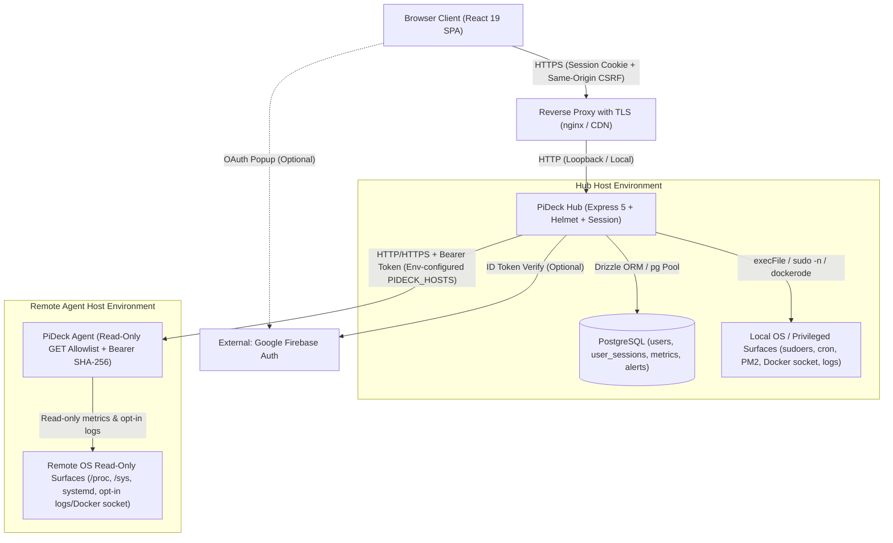

# Security Audit — hexawulf/PiDeck — 2026-11-26

## 1. Executive summary

**Overall risk rating: Medium-High** (driven by 1 High-severity historical credential exposure requiring rotation verification and 14 Medium-severity findings across authentication, network binding, denial-of-service resilience, CSP hardening, and CI/CD). No Critical vulnerabilities were found. PiDeck exhibits strong baseline security engineering in its core surfaces — parameterized Drizzle ORM queries, zero client XSS/eval sinks, strict command-argument allowlists, a DB-free read-only agent architecture, and zero vulnerable npm packages — while the identified findings concentrate in default-deployment hardening, rate-limiting/ReDoS resilience, log hygiene, and repository/CI controls. Because `hexawulf/PiDeck` is a **public repository**, maintainers should verify whether the historical credential in `SECRETS-001` was ever active on a live instance and consider opening a private GitHub Security Advisory if exposure occurred.

### Findings count by severity

| Severity | Raw Found | Deduplicated | Confirmed | Downgraded | Rejected | Fixed (PR) | Fixed (Partial + Manual) | Deferred (Manual) | Deferred (Decision) | Info |
|---|---:|---:|---:|---:|---:|---:|---:|---:|---:|---:|
| **Critical** | 0 | 0 | 0 | 0 | 0 | 0 | 0 | 0 | 0 | 0 |
| **High** | 1 | 1 | 1 | 0 | 0 | 0 | 0 | 1 | 0 | 0 |
| **Medium** | 23 | 14 | 14 | 0 | 0 | 12 | 1 | 1 | 0 | 0 |
| **Low** | 32 | 28 | 27 | 1 | 0 | 24 | 2 | 1 | 1 | 0 |
| **Info** | 4 | 4 | 4 | 0 | 0 | 0 | 0 | 0 | 0 | 4 |
| **Total** | **60** | **47** | **46** | **1** | **0** | **36** | **3** | **3** | **1** | **4** |

*Note: 13 raw findings were merged as cross-layer duplicates during independent verification (60 raw → 47 unique). `LOGGING-001` was downgraded from Medium to Low. 39 findings (36 full + 3 partial) are addressed in this PR.*

### Top 3 risks in plain language

1. **Historical admin password literal in public git history (`SECRETS-001` — High, ROTATE REQUIRED):** An older commit in the public repository included a 24-character `APP_PASSWORD` fallback literal (`UyGM****bXI3`) in an E2E test file. Although later deleted from HEAD, it remains readable in git history; any live deployment still using that password is exposed to full administrative takeover.
2. **Insecure default network binding and credential fallbacks on manual installs (`CONTAINERS-001`, `SECRETS-002`, `SECRETS-003` — Medium):** The hub defaults to binding `0.0.0.0:5006` with `TRUST_PROXY=1` (allowing direct connections to bypass a reverse proxy and spoof `X-Forwarded-For` to defeat login rate-limiting/lockout), accepts the `.env.example` placeholder `SESSION_SECRET` in production, and auto-seeds `admin`/`admin` on first DB boot without enforcing a password change.
3. **Unauthenticated DoS, ReDoS, and session-lifecycle gaps (`API-001`, `API-002`, `INJECTION-001`, `INJECTION-002`, `AUTHN-001`, `AUTHN-002` — Medium):** Unbounded in-memory maps in login rate-limiting/lockout and an unthrottled `/csp-report` endpoint enable unauthenticated memory/CPU/disk exhaustion; log filtering and redaction regexes are susceptible to ReDoS on uncapped lines; CLI password resets do not invalidate existing DB sessions; and `POST /api/auth/change-password` lacks rate-limiting, lockout, and session ID regeneration.

### **Manual actions required**

- **`SECRETS-001` (High — ROTATE REQUIRED):** Verify that `UyGM****bXI3` is not configured in `APP_PASSWORD`, `APP_PASSWORD_FILE`, the PostgreSQL `users` table, or any other service, and **rotate immediately** if still active. Do **not** rewrite shared git history. Consider a private GitHub Security Advisory if a deployed instance was affected.
- **`CICD-002` (Medium — GitHub Ruleset):** Add a `required_status_checks` rule to the `protect-main` repository ruleset requiring `check-and-test` and `e2e` to pass before merging to `main`.
- **`CONTAINERS-002` (Medium — Partial PR `866114d`; host step: Accepted risk, 2026-11-26):** This PR adds `PIDECK_DOCKER_SOCKET` / `PIDECK_AGENT_DOCKER_SOCKET` support. The operator's deployment runs PiDeck as an account that is in the `docker` group for its other work, so a socket proxy would not reduce what a compromised PiDeck process can reach. No proxy is deployed. Installs that run PiDeck as a dedicated user should use a read-only socket proxy and keep that user out of the `docker` group.
- **`CICD-003` (Low — Partial PR `64f307a` + Manual GitHub Setting):** This PR adds `github-actions` to `.github/dependabot.yml`; enable **Dependabot security updates** in GitHub Settings → Code security and analysis.
- **`CICD-004` (Low — GitHub Setting):** Enable **Private Vulnerability Reporting** in GitHub Settings → Code security and analysis so researchers can follow `SECURITY.md`.
- **`CRYPTO-002` (Low — Fixed in 2.14.1):** The installer no longer stores the admin password. It keeps it in its temporary directory for the current run only, prints a generated password once, and deletes a legacy `~/.config/pideck/admin-password` file on the next run. Later runs skip the login round-trip unless `--check-login` is given.
- **`CICD-006` (Info — Optional GitHub Setting):** Optionally enable *"Require actions to be pinned to a full-length commit SHA"* in GitHub Settings → Actions → General and add a `.github/CODEOWNERS` file.

---

## 2. Scope & method

### Audit target

| Field | Value |
|---|---|
| Repository | `hexawulf/PiDeck` (Public) |
| Application version | `2.13.3` (`releaseDate: 2026-11-24`) |
| Base branch | `main` |
| Audited commit SHA | `787ec280b2d0211d0bcbfaf68d6e69e99139e95a` |
| Audit date | `2026-11-26` |
| Execution model | Parallel swarm audit (Phase 0 recon → Phase 1 parallel layer auditors across 2 waves → Phase 2 independent fresh-agent verification → Phase 3 report → Phase 4 atomic fixes & verification → Phase 5 PR) |
| In scope | Full repository source (`server/`, `client/`, `shared/`), installer & ops scripts (`scripts/`, `deploy/`), docs/templates (`docs/`, `.env.example`, `SECURITY.md`), CI/CD (`.github/`), dependencies (`package.json`, `package-lock.json`), migrations, tests, git history (secrets scan) |
| Out of scope | External SaaS internals (Google Firebase, Cloudflare), live production host configurations, runtime network/firewall posture |

### Layer coverage (14 stack layers)

| # | Layer | Status | Scope / Proof |
|---|---|---|---|
| 1 | `secrets` | Audited | `.env.example`, Firebase config, `SESSION_SECRET`, agent tokens, git history, `.gitignore`, log redaction, public-repo PII/infra hygiene |
| 2 | `deps` | Audited | 714 npm packages (`package-lock.json`), `npm audit`, overrides, pinned `@firebase/*`, installer APT snippet, Dependabot |
| 3 | `authn` | Audited | `express-session` + PostgreSQL store, bcrypt, `APP_PASSWORD` fallback, Firebase Auth, rate-limiting/lockout, session policy, agent Bearer auth |
| 4 | `authz` | Audited | Hub `requireAuth` / `requireAuthUnlessLogin` / `__loginBypass`, ad-hoc routes, agent `AGENT_PATHS` allowlist, hub-to-agent proxy; full 73-route matrix |
| 5 | `injection` | Audited | `child_process` calls (Docker, PM2, cron, systemd, ufw, smartctl, apt-get, journalctl), log path/glob/regex filtering, Drizzle ORM, installer shell/SQL |
| 6 | `web` | Audited | React 19 SPA, Helmet, CSP & `/csp-report`, `sameOrigin` CSRF guard, optional CORS, SSRF surface in hub proxy, `localStorage` prefs |
| 7 | `api` | Audited | Express 5 `/api/*` endpoints, rate limiting, input validation, error handling, response caps, unauthenticated DoS vectors |
| 8 | `crypto` | Audited | `bcrypt`, `SESSION_SECRET`, SHA-256 + `timingSafeEqual`, CSPRNG token/password generation, TLS/HTTP transport, secret redaction |
| 9 | `containers` | Audited | No `Dockerfile` or `docker-compose*.yml` in repo; audited direct `/var/run/docker.sock` usage (`dockerode` + agent log socket client) and bind defaults |
| 10 | `infra` | Audited | Nginx templates, systemd service templates, sudoers template, DSM start script, PM2 config, installer scripts, proxy trust config |
| 11 | `cicd` | Audited | `.github/workflows/ci.yml`, `.github/dependabot.yml`, `SECURITY.md`, GitHub rulesets & security settings via `gh api` |
| 12 | `logging` | Audited | Auth & remote-log audit trails, `/csp-report` log hygiene, `redact.ts`, background job logs, Express error responses |
| 13 | `logic` | Audited | System update lock, login lockout & agent failure limiter, session lifecycle/invalidation, PM2 self-stop guard, cron concurrency |
| 14 | `llm` | **Skipped** | Provably absent: 0 LLM/AI packages in `package.json`; case-insensitive grep across `server/`, `client/src/`, `shared/`, and `package.json` for `openai`, `anthropic`, `langchain`, `ollama`, `@google/genai`, `prompt.?injection`, `system.?prompt`, `completions` returned 0 matches. ("Agent" in PiDeck is strictly a read-only HTTP metrics daemon.) |

### Tools used & unavailable fallbacks

| Category | Tools run (with versions) | Unavailable (manual review fallback) |
|---|---|---|
| Secrets | Git history & branch-diff regex + entropy inspection | `gitleaks`, `trufflehog` (unavailable on audit host) |
| SAST / Linters | `shellcheck 0.11.0`, `eslint 10.15.0`, `tsc` (`npm run check`), `check:theme` | `semgrep`, `eslint-plugin-security` |
| Dependencies | `npm 11.14.1` (`npm audit --json` → 0 vulnerabilities) | `osv-scanner` |
| Containers / IaC | Manual review of Docker socket code, nginx/systemd/sudoers templates | `trivy`, `hadolint`, `checkov`, `tfsec` |
| CI / GitHub | `gh api` (rulesets, security settings, actions permissions) + manual workflow review | `actionlint`, `zizmor` |
| Test suite | Baseline: `npm test` (707 passed, 21 DB-gated skipped), `test:install` (189 passed). Post-fix: `npm test` (769 passed, 21 DB-gated skipped), `test:install` (196 passed), `npm run build` (pass) | `test:e2e` (Playwright + live Postgres; covered in CI) |

### Limitations

- Static code review and unit/installer test execution cannot prove runtime behavior of external infrastructure (reverse proxy TLS configuration, host firewall rules, PostgreSQL authentication, or Firebase/Cloudflare tenant policies).
- `gitleaks` / `trufflehog` were unavailable on the audit host; git history secret scanning relied on scripted regex/entropy inspection across commits.
- Playwright E2E tests and PostgreSQL-backed integration tests (`history.db.test.ts`, `migrate.db.test.ts`) were not executed during Phase 0 because no live PostgreSQL instance was attached to the isolated audit clone.

---

## 3. Architecture & trust boundaries

PiDeck operates in two runtime modes built from a single TypeScript codebase:

1. **Hub mode (`server/hub.ts`):** Serves the React 19 SPA and Express 5 REST API, persists sessions (`user_sessions`), admin credentials (`users`), 60-second sampled metrics (`historical_metrics`), and alerts (`alerts`) in PostgreSQL, executes local host diagnostics/actions (Docker, PM2, cron, `apt-get` updates, `ufw`, `smartctl`, host logs), and proxies read-only requests to configured remote agents (`/api/hosts/:id/*`).
2. **Agent mode (`PIDECK_MODE=agent`, `server/agent.ts`):** A lightweight, DB-free, strictly read-only JSON daemon authenticated via `Authorization: Bearer <token>` (SHA-256 + `timingSafeEqual`) behind an exact `GET`-only route allowlist.



Key trust boundaries:
- **Browser ↔ Reverse Proxy ↔ Hub:** Session cookies (`pideck.sid`), `requireSameOrigin` CSRF guard, CSP/Helmet headers, login rate-limiting/lockout, and `TRUST_PROXY` client-IP resolution.
- **Hub ↔ PostgreSQL:** Parameterized Drizzle queries, session persistence, and advisory locks.
- **Hub ↔ Local OS:** Privileged `sudo -n` allowlist (`smartctl`, `ufw`, `apt-get`), Docker socket, PM2 daemon, crontab execution, and host log file reading.
- **Hub ↔ Remote Agent:** Environment-defined agent URLs and 256-bit Bearer tokens, strict hub-side URL allowlist, and agent-side `agentAuth` + `agentAllows`.

---

## 4. Findings

Findings are ordered by severity (**High → Medium → Low → Info**) and grouped by layer.

---

### High

#### [HIGH] SECRETS-001 — Hard-coded APP_PASSWORD fallback committed in public git history (ROTATE REQUIRED)
- **Location:** `tests/auth.login.e2e.test.ts` (git commit `3f83b90f28`, line 22; deleted in `735522ab65`)
- **Layer:** `secrets` | **CWE:** CWE-798 | **OWASP:** A07:2021 | **Confidence:** Confirmed
- **Description:** A 24-character high-entropy fallback literal for `APP_PASSWORD` was committed to an E2E test file in the public repository history. Although the file was later removed from `HEAD`, the literal remains permanently accessible in git history. Removing a secret from `HEAD` does not remediate the exposure.
- **Evidence:**
  ```ts
  // commit 3f83b90f28:tests/auth.login.e2e.test.ts:22
  const password = process.env.APP_PASSWORD || 'UyGM****bXI3';
  ```
- **Exploit scenario:** An unauthenticated third party cloning this public repository can inspect commit `3f83b90f28` and recover the literal password. If that value is still configured as `APP_PASSWORD`, `APP_PASSWORD_FILE`, or the PostgreSQL `admin` password on a live hub, it grants full administrative login via `POST /api/auth/login`.
- **Preconditions:** The leaked literal is still active on a reachable PiDeck instance (or reused on another service).
- **Recommended fix:** **ROTATE REQUIRED.** Verify that `UyGM****bXI3` is not used in `APP_PASSWORD`, `APP_PASSWORD_FILE`, the PostgreSQL `users` table, or any other service, and rotate immediately if active. Do not rewrite shared git history. Consider a private GitHub Security Advisory if a live deployment was affected.
- **Status:** `Deferred — manual action`

---

### Medium

#### [MEDIUM] SECRETS-002 — Hub accepts .env.example placeholder and short SESSION_SECRET in production and falls back to hard-coded secret outside production
- **Location:** `server/hub.ts:28-29`, `server/hub.ts:51-55`, `server/hub.ts:112-114`, `.env.example:17-18`
- **Layer:** `secrets` | **CWE:** CWE-798 | **OWASP:** A02:2021 | **Confidence:** Confirmed *(merged: `AUTHN-004`, `CRYPTO-001`, `INFRA-001` [partial])*
- **Description:** `server/hub.ts` falls back to the hardcoded literal `"CHANGE_ME_SESSION_SECRET_LONG_RANDOM"` when `SESSION_SECRET` is unset, and its production startup check only verifies `!process.env.SESSION_SECRET`. Meanwhile, `.env.example` ships an uncommented `SESSION_SECRET=CHANGE_ME_SESSION_SECRET_LONG_RANDOM`.
- **Evidence:**
  ```ts
  // server/hub.ts:29, 112-114
  const SESSION_SECRET = process.env.SESSION_SECRET || "CHANGE_ME_SESSION_SECRET_LONG_RANDOM";
  if (IS_PRODUCTION && !process.env.SESSION_SECRET) { ... }
  ```
- **Exploit scenario:** An operator copying `.env.example` manually without replacing `SESSION_SECRET`, supplying a short/whitespace string, or running with `NODE_ENV` unset passes startup validation. Express then signs `pideck.sid` cookies with a publicly known literal, undermining cookie HMAC integrity.
- **Preconditions:** Manual deployment retaining the `.env.example` placeholder, a weak secret, or non-production `NODE_ENV`.
- **Recommended fix:** Trim `process.env.SESSION_SECRET` in `server/hub.ts` and reject missing values, placeholder patterns (`/^CHANGE_ME/i`), and secrets shorter than 32 characters in production; outside production use an ephemeral `crypto.randomBytes(32).toString("hex")` fallback. Comment out `SESSION_SECRET` in `.env.example`.
- **Status:** `Fixed (c7d209f)`

#### [MEDIUM] SECRETS-003 — Hard-coded default admin password ('admin') auto-seeded on first database boot without forced change
- **Location:** `server/storage.ts:71-89`, `docs/INSTALL.md:838-844`
- **Layer:** `secrets` | **CWE:** CWE-1188 | **OWASP:** A07:2021 | **Confidence:** Confirmed *(merged: `AUTHN-003`, `INFRA-001` [partial])*
- **Description:** On an empty `users` table, `initializeStorage()` automatically inserts `admin` with a hardcoded bcrypt hash of `"admin"`. `adminPasswordIsDefault()` only displays a non-blocking UI banner rather than preventing privileged API use.
- **Evidence:**
  ```ts
  // server/storage.ts:72, 81-86
  export const DEFAULT_ADMIN_HASH = "$2b$10$hAevPiEi8nM5HzWk4VcJteq3NIQb3GgHIfDu/aeMCUImiuVfApa8C";
  if (!admin) { admin = await storage.createUser({ username: "admin", password_hash: DEFAULT_ADMIN_HASH }); }
  ```
- **Exploit scenario:** On a manual deployment (without `scripts/install.sh` replacing the seeded password) or after a database reset, any network-reachable attacker can log in as `admin`/`admin` via `POST /api/auth/login` and immediately invoke privileged endpoints (cron, `apt-get upgrade`, Docker, PM2).
- **Preconditions:** Hub started against an empty `users` table without `scripts/install.sh` replacing the default password, and hub is network-reachable.
- **Recommended fix:** In production (`NODE_ENV === "production"`), refuse to auto-seed the hardcoded `"admin"` hash (requiring `install-helper.mjs set-admin` or `APP_PASSWORD_FILE`) or enforce a forced-change gate restricting authenticated sessions to `/api/auth/me`, `/api/auth/logout`, and `POST /api/auth/change-password` while `adminPasswordIsDefault()` is true.
- **Status:** `Fixed (fac8eb5)`

#### [MEDIUM] AUTHN-001 — CLI password reset does not invalidate active database sessions
- **Location:** `scripts/install-helper.mjs:95-117`
- **Layer:** `authn` | **CWE:** CWE-613 | **OWASP:** A07:2021 | **Confidence:** Confirmed
- **Description:** Unlike `POST /api/auth/change-password` (which revokes other sessions in `server/routes.ts:457`), the `set-admin` subcommand in `scripts/install-helper.mjs` updates `users.password_hash` without deleting rows from `user_sessions`.
- **Evidence:**
  ```js
  // scripts/install-helper.mjs:105-113
  // Updates users.password_hash only; no DELETE FROM user_sessions
  ```
- **Exploit scenario:** An attacker holding a hijacked `pideck.sid` session cookie retains full administrative access for up to `PIDECK_SESSION_MAX_DAYS` (default 30 days) even after the operator runs `scripts/install.sh --reset-password`.
- **Preconditions:** Attacker holds a valid session cookie issued prior to the CLI password reset.
- **Recommended fix:** In `scripts/install-helper.mjs` under `set-admin`, after updating `users`, run `DELETE FROM user_sessions` whenever `to_regclass('public.user_sessions') IS NOT NULL`.
- **Status:** `Fixed (7870459)`

#### [MEDIUM] AUTHN-002 — POST /api/auth/change-password lacks rate limiting, lockout, and session ID regeneration
- **Location:** `server/routes.ts:430-468`
- **Layer:** `authn` | **CWE:** CWE-307 | **OWASP:** A07:2021 | **Confidence:** Confirmed *(merged: `API-003`, `LOGIC-002`)*
- **Description:** `POST /api/auth/change-password` mounts only `requireAuth` — without `rateLimitLogin` or `loginLockout` — and deletes other rows from `user_sessions` without calling `req.session.regenerate()` on the caller's own session.
- **Evidence:**
  ```ts
  // server/routes.ts:430-460
  app.post("/api/auth/change-password", requireAuth, async (req, res) => { ... });
  ```
- **Exploit scenario:** An attacker with a hijacked session cookie or a Firebase-authenticated session can submit unlimited guesses for `currentPassword` at full bcrypt speed (brute-forcing the local password or exhausting CPU), and the pre-change session ID remains valid after a legitimate password rotation.
- **Preconditions:** Attacker holds an authenticated hub session.
- **Recommended fix:** Apply `rateLimitLogin` and `loginLockout` checks to `POST /api/auth/change-password`, and regenerate the caller's session via `req.session.regenerate()` (re-populating session fields and saving) before deleting other rows from `user_sessions`.
- **Status:** `Fixed (249af55)`

#### [MEDIUM] CONTAINERS-001 — Hub defaults to binding 0.0.0.0:5006 with TRUST_PROXY=1, enabling reverse-proxy bypass and X-Forwarded-For rate-limit spoofing
- **Location:** `server/config.ts:117-124`, `server/config.ts:165-169`, `scripts/install/hub.sh:117-130`, `docs/INSTALL.md:140-143`
- **Layer:** `containers` | **CWE:** CWE-668 | **OWASP:** A05:2021 | **Confidence:** Confirmed *(merged: `AUTHN-005` [partial], `LOGIC-001` [partial])*
- **Description:** `server/config.ts` defaults `PIDECK_BIND` to `0.0.0.0` and `TRUST_PROXY` to `1`, and `scripts/install/hub.sh` never writes `PIDECK_BIND=127.0.0.1` for reverse-proxy installs — contradicting `docs/INSTALL.md:142` (*"It leaves PiDeck on 127.0.0.1:PORT"*).
- **Evidence:**
  ```ts
  // server/config.ts:119, 166
  // TRUST_PROXY defaults to 1; hubBind() defaults PIDECK_BIND to "0.0.0.0"
  ```
- **Exploit scenario:** On a default reverse-proxy install where port 5006 is not firewalled, a network peer can connect directly to `http://<host>:5006` (bypassing TLS, WAF, and proxy IP allowlists) and send a spoofed `X-Forwarded-For` header on every `POST /api/auth/login`, defeating both `rateLimitLogin` and per-IP `loginLockout`.
- **Preconditions:** Hub port 5006 is directly reachable without a reverse proxy stripping `X-Forwarded-For` and `PIDECK_BIND` was not manually restricted.
- **Recommended fix:** In `scripts/install/hub.sh` (`write_env`), set `want[PIDECK_BIND]=127.0.0.1` when `LAN_HTTP != 1` (and `0.0.0.0` only with `--lan-http`). In `server/config.ts` (`hubBind`), default to `127.0.0.1` unless `PIDECK_INSECURE_HTTP === "1"`.
- **Status:** `Fixed (fd0fc29)`

#### [MEDIUM] API-001 — Unbounded in-memory maps in login rate limiter and lockout allow memory exhaustion and O(N^2) CPU DoS
- **Location:** `server/middleware/rateLimitLogin.ts:4-48`, `server/services/login-lockout.ts:12-48`
- **Layer:** `api` | **CWE:** CWE-770 | **OWASP:** A04:2021 | **Confidence:** Confirmed *(merged: `AUTHN-005` [partial], `LOGIC-001` [partial])*
- **Description:** Neither `bucket` (`rateLimitLogin.ts:4`) nor `entries` (`login-lockout.ts:13`) enforces a maximum entry cap, and `login-lockout.ts:28` invokes a full-map `prune(t)` on every failed login attempt.
- **Evidence:**
  ```ts
  // server/middleware/rateLimitLogin.ts:4 & server/services/login-lockout.ts:13, 28
  const bucket = new Map<string, ...>(); // unbounded
  const entries = new Map<string, ...>(); // unbounded; full prune(t) on every failure()
  ```
- **Exploit scenario:** An unauthenticated attacker sends failed `POST /api/auth/login` requests from many distinct source IPs (e.g., an IPv6 `/64`, distributed hosts, or spoofed `X-Forwarded-For`), growing both maps without bound (OOM risk on constrained hardware) while triggering `O(N)` map scans per failure (`O(N^2)` CPU stall).
- **Preconditions:** Hub is reachable by an unauthenticated attacker able to vary source IPs.
- **Recommended fix:** Enforce a `maxEntries` cap (e.g., 10,000 with oldest-entry eviction) on both maps, throttle `loginLockout.prune()` to at most once per minute, and validate `CF-Connecting-IP` format when `PIDECK_CLOUDFLARE=1`.
- **Status:** `Fixed (c0a25b7)`

#### [MEDIUM] INJECTION-001 — ReDoS bypass in log filter regex screening (lineFilter / hasNestedQuantifier)
- **Location:** `server/services/log-filter.ts:40-89`, `server/routes/hostLogs.ts:250-270`, `server/services/agent-logs/sources.ts:274-286`
- **Layer:** `injection` | **CWE:** CWE-1333 | **OWASP:** A03:2021 | **Confidence:** Confirmed
- **Description:** `hasNestedQuantifier()` in `server/services/log-filter.ts` only flags quantifiers applied immediately after a closing `)` of a risky group. Ungrouped overlapping quantifiers and quantified backreferences bypass the check and execute synchronously via `RegExp.test()` on the Node.js event loop.
- **Evidence:**
  ```ts
  // server/services/log-filter.ts:40-65
  // Only inspects quantified closing groups; does not reject backreferences or overlapping ungrouped quantifiers
  ```
- **Exploit scenario:** An authenticated hub user (or valid agent Bearer token holder) supplies a short regex with sequential overlapping ungrouped quantifiers or backreferences to `GET /api/hostlogs/:id?grep=/.../` (or remote agent logs), stalling the Node.js event loop across up to 5,000 uncapped log lines.
- **Preconditions:** Authenticated hub session or valid agent Bearer token.
- **Recommended fix:** Reject backreferences (`\[1-9]`, `\k<`) and overlapping/multiple unbounded quantifiers in `server/services/log-filter.ts` (or use linear-time matching), and cap log line lengths in `server/routes/hostLogs.ts` before matching.
- **Status:** `Fixed (5cfa6dc)`

#### [MEDIUM] INJECTION-002 — Quadratic ReDoS in log redaction regexes amplified by uncapped hub log line lengths
- **Location:** `server/services/agent-logs/redact.ts:35-49`, `server/routes/hostLogs.ts:262-270`
- **Layer:** `injection` | **CWE:** CWE-1333 | **OWASP:** A03:2021 | **Confidence:** Confirmed
- **Description:** The `url-credentials` and `key-value` redaction patterns in `server/services/agent-logs/redact.ts` anchor on `\b` while allowing dot/hyphen separators inside their leading character classes, causing quadratic backtracking on long non-matching tokens. In `server/routes/hostLogs.ts:266`, uncapped log lines are passed directly to `redactLine()`.
- **Evidence:**
  ```ts
  // server/services/agent-logs/redact.ts:36, 43
  // Leading \b combined with dot/hyphen-consuming character class (timed at 37.66ms on a single 4,001-char line)
  ```
- **Exploit scenario:** An unauthenticated remote client writes long dot/hyphen-separated request paths or User-Agent strings into an access log. When an operator views that log in PiDeck, `redactLine()` performs `O(n^2)` backtracking on uncapped lines and stalls the event loop.
- **Preconditions:** External client can cause long dot/hyphen strings to be written to a monitored log and an operator opens that log.
- **Recommended fix:** Replace leading `\b` with negative lookbehinds (`(?<![a-z0-9+.-])` and `(?<![A-Za-z0-9_.-])`) in `server/services/agent-logs/redact.ts`, and apply an 8 KB line-length cap before `redactLine()` in `server/routes/hostLogs.ts`.
- **Status:** `Fixed (5f36ee4)`

#### [MEDIUM] WEB-001 — Overly permissive wildcard *.firebaseapp.com and *.firebaseio.com in CSP directives when Firebase Auth is enabled
- **Location:** `server/security.ts:21-37`, `server/security.ts:58-63`
- **Layer:** `web` | **CWE:** CWE-693 | **OWASP:** A05:2021 | **Confidence:** Confirmed
- **Description:** When `FIREBASE_ENABLED=true`, `server/security.ts` adds `https://*.firebaseapp.com` to `script-src`, `connect-src`, and `frame-src`, plus `https://*.firebaseio.com` to `connect-src`.
- **Evidence:**
  ```ts
  // server/security.ts:21-37
  // Allowlists https://*.firebaseapp.com in script-src/connect-src/frame-src and https://*.firebaseio.com in connect-src
  ```
- **Exploit scenario:** Anyone can host arbitrary JavaScript on a free `<attacker>.firebaseapp.com` project. If an HTML or script-tag injection ever occurs on a Firebase-enabled hub, `script-src https://*.firebaseapp.com` permits loading attacker-controlled scripts, bypassing `'self'` and SHA-256 hashes.
- **Preconditions:** `FIREBASE_ENABLED=true` combined with an HTML/script injection vector.
- **Recommended fix:** Resolve the exact Firebase auth domain from `FIREBASE_CLIENT_AUTH_DOMAIN` or `${FIREBASE_PROJECT_ID}.firebaseapp.com` (validated as a single hostname without wildcards) in `cspDirectives()`, remove `https://*.firebaseapp.com` from `script-src`, scope `frame-src`/`connect-src` to the exact `authDomain`, and remove unused `https://*.firebaseio.com`.
- **Status:** `Fixed (2ad305a)`

#### [MEDIUM] API-002 — Unauthenticated POST /csp-report endpoint lacks rate limiting, enabling log flooding and disk exhaustion
- **Location:** `server/security.ts:109-118`, `server/hub.ts:96`
- **Layer:** `api` | **CWE:** CWE-770 | **OWASP:** A04:2021 | **Confidence:** Confirmed
- **Description:** In production, `installCsp()` mounts `POST /csp-report` without authentication, same-origin checks, or rate limiting, calling `console.warn` on every request.
- **Evidence:**
  ```ts
  // server/security.ts:109-118
  app.post("/csp-report", express.json({ type: ..., limit: "8kb" }), (req, res) => { console.warn(...); res.status(204).end(); });
  ```
- **Exploit scenario:** Any unauthenticated remote caller can continuously POST JSON bodies to `/csp-report`, writing ~650 bytes per request to server logs to exhaust disk space and drown out genuine security alerts.
- **Preconditions:** Hub running with `NODE_ENV=production` and reachable by an unauthenticated caller.
- **Recommended fix:** Add a lightweight in-memory per-IP and global rate limiter (with bounded map size) to `POST /csp-report` in `server/security.ts`, silently returning `204` without logging when throttled.
- **Status:** `Fixed (41091a8)`

#### [MEDIUM] CONTAINERS-002 — Direct /var/run/docker.sock access via docker group grants root-equivalent privilege escalation and dockerRouter hardcodes the socket path
- **Location:** `server/routes/docker.ts:5-11`, `server/agent.ts:98`, `docs/INSTALL.md:62`, `docs/INSTALL.md:778-785`
- **Layer:** `containers` | **CWE:** CWE-250 | **OWASP:** A05:2021 | **Confidence:** Confirmed
- **Description:** `server/routes/docker.ts:5` hardcodes `new Dockerode({ socketPath: "/var/run/docker.sock" })`, ignoring `PIDECK_AGENT_DOCKER_SOCKET` even when mounted on the agent (`server/agent.ts:98`), and `docs/INSTALL.md` instructs adding the service user directly to the `docker` group.
- **Evidence:**
  ```ts
  // server/routes/docker.ts:5
  const docker = new Dockerode({ socketPath: "/var/run/docker.sock" });
  ```
- **Exploit scenario:** If an attacker obtains code execution as the PiDeck hub or agent OS user, direct read/write access to `/var/run/docker.sock` provides trivial privilege escalation to host root via container creation.
- **Preconditions:** PiDeck hub or agent user is a member of the `docker` group and an attacker achieves code execution as that user.
- **Recommended fix:** Honor `PIDECK_DOCKER_SOCKET` / `PIDECK_AGENT_DOCKER_SOCKET` (defaulting to `/var/run/docker.sock`) in `server/routes/docker.ts` and document deploying a read-only Docker socket proxy in `docs/INSTALL.md` (PR portion); on live hosts, optionally deploy a socket proxy and remove the service user from the `docker` group (manual portion).
- **Status:** `Fixed — partial + manual (866114d)`

#### [MEDIUM] CICD-001 — CI executes npm lifecycle scripts without --ignore-scripts and performs unverified global npm install
- **Location:** `.github/workflows/ci.yml:53-57`, `.github/workflows/ci.yml:110-114`
- **Layer:** `cicd` | **CWE:** CWE-829 | **OWASP:** A08:2021 | **Confidence:** Confirmed
- **Description:** Both `check-and-test` and `e2e` jobs in `.github/workflows/ci.yml` run `npm install -g npm@11.13.0` and `npm ci --no-audit --no-fund` without `--ignore-scripts`.
- **Evidence:**
  ```yaml
  # .github/workflows/ci.yml:53-57, 110-114
  npm install -g npm@11.13.0
  npm ci --no-audit --no-fund
  ```
- **Exploit scenario:** A compromised upstream dependency carrying a `postinstall` script executes arbitrary code inside the GitHub Actions runner during `npm ci` before any checks run, risking cache poisoning or build artifact tampering.
- **Preconditions:** Upstream dependency compromise or a PR introducing a malicious install script.
- **Recommended fix:** Add `--ignore-scripts` to both `npm ci` commands and `npm install -g` in `.github/workflows/ci.yml`, and verify locally that unit tests, lint, and build still pass (already confirmed in Phase 0 baseline).
- **Status:** `Fixed (7875639)`

#### [MEDIUM] CICD-002 — protect-main ruleset does not require CI status checks before merging
- **Location:** `.github/workflows/ci.yml:19-20`, `.github/workflows/ci.yml:80-81` (GitHub repository ruleset `protect-main`, id `27815719`)
- **Layer:** `cicd` | **CWE:** CWE-693 | **OWASP:** A05:2021 | **Confidence:** Confirmed
- **Description:** GitHub API inspection of the `protect-main` ruleset confirms only `deletion`, `non_fast_forward`, and `pull_request` rules are configured; no `required_status_checks` rule exists.
- **Evidence:**
  ```text
  GitHub API ruleset protect-main (id 27815719):
  rules = ["deletion", "non_fast_forward", "pull_request"] (no required_status_checks)
  ```
- **Exploit scenario:** A PR failing security unit tests, ESLint, ShellCheck, or Playwright E2E tests can be merged into `main` without GitHub blocking the merge.
- **Preconditions:** A PR is merged while CI checks are failing, skipped, or still running.
- **Recommended fix:** Add a `required_status_checks` rule to the `protect-main` ruleset in GitHub Settings requiring `check-and-test` and `e2e` to pass before merging.
- **Status:** `Deferred — manual action`

#### [MEDIUM] LOGGING-002 — Global Express error handler and NVMe route leak raw internal error messages and smartctl stderr to clients
- **Location:** `server/hub.ts:155-165`, `server/routes/nvme.ts:20-25`
- **Layer:** `logging` | **CWE:** CWE-209 | **OWASP:** A05:2021 | **Confidence:** Confirmed
- **Description:** The global error handler in `server/hub.ts:158-160` returns `httpErr?.message` verbatim for 5xx `/api/*` responses, and `server/routes/nvme.ts:24` returns `(stderr || err.message).slice(0, 200)` in `details`.
- **Evidence:**
  ```ts
  // server/hub.ts:158-160 & server/routes/nvme.ts:24
  // Returns httpErr?.message verbatim on 5xx /api/*; nvme.ts returns raw stderr/err.message in JSON details
  ```
- **Exploit scenario:** Unhandled 5xx exceptions (database errors, middleware failures) on `/api/*` expose internal file paths, SQL error strings, or stack context to callers; `/api/metrics/nvme` leaks raw `sudo`/`smartctl` stderr.
- **Preconditions:** Triggering an unhandled 5xx error on `/api/*` or a non-classified `smartctl` failure.
- **Recommended fix:** Return a generic `"Internal Server Error"` for 5xx responses in `server/hub.ts` (exposing safe messages only for explicit 4xx errors). In `server/routes/nvme.ts`, log `stderr` server-side and return only `{ error: "SMART data unavailable" }`.
- **Status:** `Fixed (f42e0ad)`

---

### Low

#### [LOW] LOGGING-001 — Log injection via unauthenticated /csp-report (ANSI/control chars) and unsanitized auth log fields
- **Location:** `server/security.ts:109-118`, `server/routes.ts:224`, `server/routes.ts:458`, `server/services/firebase-auth.ts:155`
- **Layer:** `logging` | **CWE:** CWE-117 | **OWASP:** A09:2021 | **Confidence:** Confirmed *(Downgraded from Medium: CRLF `\r\n` is already stripped on `/csp-report`, preventing classic multi-line log forging; remaining impact is ANSI/control-character terminal manipulation and auth-log hygiene)*
- **Description:** `server/security.ts:114` only strips `[\r\n]` (leaving ANSI escape sequences, C0/C1 control chars, and Unicode line separators `U+2028`/`U+2029`), while `server/routes.ts:224,458` and `server/services/firebase-auth.ts:155` log `clientKey(req)` and email values without control-character sanitization.
- **Evidence:**
  ```ts
  // server/security.ts:114 (strips only [\r\n]); server/routes.ts:224, 458 & firebase-auth.ts:155 (unsanitized fields)
  ```
- **Exploit scenario:** An unauthenticated caller sends ANSI escape sequences or control characters in `POST /csp-report` fields (or crafted headers when `PIDECK_CLOUDFLARE=1` is misconfigured), obfuscating log output or injecting terminal escape sequences when logs are viewed interactively.
- **Preconditions:** Hub running in production and operator viewing logs in a terminal.
- **Recommended fix:** Add a shared log-sanitization helper stripping `/[\u0000-\u001f\u007f-\u009f\u2028\u2029]/g` and apply it in `server/security.ts`, `server/routes.ts`, and `server/services/firebase-auth.ts`.
- **Status:** `Fixed (b580e4d)`

#### [LOW] SECRETS-004 — .gitignore omits Firebase Admin SDK default key filenames, alternate .env.* files, and key/dump artefacts
- **Location:** `.gitignore:12-17`, `.gitignore:129-132`, `.gitignore:144-152`
- **Layer:** `secrets` | **CWE:** CWE-538 | **OWASP:** A05:2021 | **Confidence:** Confirmed
- **Description:** `.gitignore` ignores `.env`, `.env.local`, `.env.*.local`, `.env.test`, `.env.bak.*`, `*.pem`, `*.crt`, `*.key`, and `*firebase-service-account*.json`, but omits `.env.*` (with `!.env.example`), `*-firebase-adminsdk-*.json`, `*service-account*.json`, `*.p12`, `*.pfx`, `*.jks`, and `*.dump`.
- **Evidence:**
  ```gitignore
  # .gitignore:12-17, 129-132, 144-152 — missing .env.*, *-firebase-adminsdk-*.json, *.p12, *.pfx, *.jks, *.dump
  ```
- **Exploit scenario:** A contributor places a default-named Firebase Admin SDK key JSON, `.env.production`/`.env.agent`, or database `.dump` file in the working tree and accidentally commits it to this public repository.
- **Preconditions:** Contributor stores local secret or dump files inside the repo directory and stages broadly.
- **Recommended fix:** Add `.env.*`, `!.env.example`, `*-firebase-adminsdk-*.json`, `*service-account*.json`, `*.p12`, `*.pfx`, `*.jks`, and `*.dump` to `.gitignore`.
- **Status:** `Fixed (aee1947)`

#### [LOW] SECRETS-005 — Operator emails, internal LAN/tunnel IPs, hostnames, and local usernames exposed in public config templates, deploy scripts, docs, and tests
- **Location:** `.env.example:35-37,86-100`, `deploy/dsm/start-agent.sh:1-21`, `docs/nginx/pideck.piapps.dev.conf:3-12`, `scripts/install.sh:15`, `docs/INSTALL.md:380-428,560-788`, `tests/unit/firebase-auth.test.ts:25-30`
- **Layer:** `secrets` | **CWE:** CWE-200 | **OWASP:** A05:2021 | **Confidence:** Confirmed *(merged: `INFRA-006`)*
- **Description:** Publicly committed templates, scripts, documentation, and unit tests contain operator email addresses (including authorized `FIREBASE_ALLOWED_EMAILS` examples), hardcoded local usernames/home directories, real domain paths, and internal RFC 1918 IP/hostname mappings.
- **Evidence:**
  ```text
  Real operator emails, local OS usernames, and internal RFC 1918 IP/hostname references found in .env.example,
  deploy/dsm/start-agent.sh, docs/nginx/pideck.piapps.dev.conf, scripts/install.sh, docs/INSTALL.md, and tests/unit/firebase-auth.test.ts.
  ```
- **Exploit scenario:** An attacker inspecting the public repository harvests authorized Google login emails for targeted phishing and maps internal hostnames, OS usernames, and network addressing.
- **Preconditions:** Public repository access and production use of the documented emails, usernames, or internal layout.
- **Recommended fix:** Replace personal emails, usernames, hostnames, domains, and private IPs with RFC 2606 (`example.com`) and RFC 5737 (`192.0.2.x` / `198.51.100.x`) placeholders across the listed files, and parameterize `deploy/dsm/start-agent.sh` using `$HOME`/`$USER` or environment variables.
- **Status:** `Fixed (2559bac)`

#### [LOW] DEPS-002 — NodeSource APT setup snippet uses predictable /tmp paths without error chaining
- **Location:** `scripts/install/hub.sh:60-75`
- **Layer:** `deps` | **CWE:** CWE-377 | **OWASP:** A08:2021 | **Confidence:** Confirmed
- **Description:** `scripts/install/hub.sh:66-71` prints unchained shell commands that write to predictable `/tmp/nodesource.gpg.key` and `/tmp/nodesource.list` paths before passing them to `sudo gpg --dearmor` and `sudo install`.
- **Evidence:**
  ```bash
  # scripts/install/hub.sh:66-71
  # Unchained commands writing to /tmp/nodesource.gpg.key and /tmp/nodesource.list before sudo install
  ```
- **Exploit scenario:** On a multi-user Linux host, a local attacker pre-creates those `/tmp` files; when an admin pastes the snippet into an interactive shell without `set -e`, `curl`/`echo` fail silently and `sudo` installs the attacker's APT key and repository.
- **Preconditions:** Multi-user host with a local attacker; Node 22 not yet installed; operator pastes the printed snippet.
- **Recommended fix:** Update the printed snippet in `scripts/install/hub.sh:66-71` to use a private `mktemp -d` directory chained with `&&` (or pipe directly to `sudo gpg --dearmor` and `sudo tee` without `/tmp` files).
- **Status:** `Fixed (2343131)`

#### [LOW] AUTHN-006 — express-session hardcodes proxy: true, overriding TRUST_PROXY=false
- **Location:** `server/hub.ts:39`, `server/hub.ts:51-79`
- **Layer:** `authn` | **CWE:** CWE-348 | **OWASP:** A05:2021 | **Confidence:** Confirmed
- **Description:** `server/hub.ts:39` configures `app.set("trust proxy", TRUST_PROXY)`, but line 66 hardcodes `proxy: true` inside `session({...})`, causing `express-session` to ignore `TRUST_PROXY=false`.
- **Evidence:**
  ```ts
  // server/hub.ts:39, 66
  app.set("trust proxy", TRUST_PROXY);
  app.use(session({ ..., proxy: true, ... }));
  ```
- **Exploit scenario:** When `TRUST_PROXY=false` is configured in production (without `PIDECK_INSECURE_HTTP=1`), `express-session` still trusts client-supplied `X-Forwarded-Proto: https`, allowing a plain-HTTP client to receive `Secure` session cookies over cleartext HTTP.
- **Preconditions:** Hub run with `TRUST_PROXY=false` in production over plain HTTP.
- **Recommended fix:** Remove `proxy: true` from `session({...})` in `server/hub.ts:66` so `express-session` inherits `app.get("trust proxy")`.
- **Status:** `Fixed (9fbfc4c)`

#### [LOW] AUTHN-007 — Firebase ID token verification does not check token revocation
- **Location:** `server/services/firebase-auth.ts:135-141`
- **Layer:** `authn` | **CWE:** CWE-613 | **OWASP:** A07:2021 | **Confidence:** Confirmed *(merged: `LOGIC-005`)*
- **Description:** `server/services/firebase-auth.ts:137` calls `getAuth(app).verifyIdToken(idToken.trim())` without `checkRevoked = true`.
- **Evidence:**
  ```ts
  // server/services/firebase-auth.ts:137
  const decoded = await getAuth(app).verifyIdToken(idToken.trim());
  ```
- **Exploit scenario:** After an authorized Firebase account is disabled or its refresh tokens are revoked, an attacker holding a recently issued ID token (valid up to 1 hour) can still exchange it at `POST /api/auth/firebase-login` for a fresh 30-day PiDeck session.
- **Preconditions:** `FIREBASE_ENABLED=true` and attacker holds an unexpired ID token from a revoked/disabled Firebase user.
- **Recommended fix:** Pass `true` as the second argument: `await getAuth(app).verifyIdToken(idToken.trim(), true)` in `server/services/firebase-auth.ts:137`.
- **Status:** `Fixed (de19b91)`

#### [LOW] AUTHN-008 — Agent auth checks bearer token before enforcing per-IP 429 block and clears all IPs on map overflow
- **Location:** `server/middleware/agentAuth.ts:50-75`
- **Layer:** `authn` | **CWE:** CWE-307 | **OWASP:** A07:2021 | **Confidence:** Confirmed *(merged: `LOGIC-006`)*
- **Description:** `server/middleware/agentAuth.ts:52` calls `failures.clear()` when `failures.size > 10_000`, wiping all active per-IP blocks at once, and lines 65–72 evaluate `tokenMatches` before `limiter.blocked(key)` (note: lines 27–32 document allowing a valid token during a block for hub recovery).
- **Evidence:**
  ```ts
  // server/middleware/agentAuth.ts:52, 65-72
  if (failures.size > 10_000) failures.clear();
  ```
- **Exploit scenario:** Spraying invalid requests from >10,000 source IPs resets all active per-IP rate-limit blocks simultaneously, and a blocked IP still gets candidate tokens evaluated (relevant if an operator manually set a weak token).
- **Preconditions:** Attacker can reach the agent port with >10,000 source IPs or against a weak manual token.
- **Recommended fix:** Replace `failures.clear()` with expired-entry pruning and oldest-entry eviction in `server/middleware/agentAuth.ts:52`; review `tests/unit/agent.test.ts` before altering the documented valid-token recovery ordering.
- **Status:** `Fixed (2b793bd)`

#### [LOW] AUTHZ-001 — Loose prefix-based auth bypass (__loginBypass / requireAuthUnlessLogin) skips requireAuth for any /api/auth/login* or /api/auth/firebase-login* path
- **Location:** `server/routes.ts:80-89`, `server/routes.ts:269-287`
- **Layer:** `authz` | **CWE:** CWE-863 | **OWASP:** A01:2021 | **Confidence:** Confirmed
- **Description:** `server/routes.ts:84` and `280-282` use `startsWith('/api/auth/login')`, `startsWith('/auth/login')`, and `startsWith('/api/auth/firebase-login')` to set `__loginBypass` or skip `requireAuth` for any path sharing those prefixes.
- **Evidence:**
  ```ts
  // server/routes.ts:84, 280-282
  // Prefix-based bypass via url.startsWith("/api/auth/login") / startsWith("/api/auth/firebase-login")
  ```
- **Exploit scenario:** Unauthenticated requests to `/api/auth/login*` return `404` instead of `401` (breaking the `server/hub.ts:138` invariant), and any future route mounted under those prefixes would silently bypass even an explicit `requireAuth` guard.
- **Preconditions:** Unauthenticated network access to the Hub API; handler bypass requires a future route sharing the prefix.
- **Recommended fix:** Remove `__loginBypass` (`server/routes.ts:80-89`), remove the `__loginBypass` branch in `requireAuth`, delete `requireAuthUnlessLogin`, and mount a single explicit `app.use("/api", requireAuth)` barrier immediately after `/api/auth/me`.
- **Status:** `Fixed (357718c)`

#### [LOW] AUTHZ-002 — Privileged mutating Hub routes lack direct requireAuth middleware and rely on incidental /api router mount ordering
- **Location:** `server/routes.ts:290-295`, `server/routes.ts:326-427`
- **Layer:** `authz` | **CWE:** CWE-862 | **OWASP:** A01:2021 | **Confidence:** Confirmed
- **Description:** Eleven ad-hoc routes (`POST /api/system/update`, `GET /api/system/update`, `GET /api/reboot-check`, Docker start/stop/restart, PM2 restart/stop, `GET /api/cron/jobs`, `POST /api/cron/run`, plus an unreachable duplicate `GET /api/pm2/processes` at lines 368–376) omit direct `requireAuth` and rely solely on five earlier `/api` router mounts.
- **Evidence:**
  ```ts
  // server/routes.ts:329-427 — 11 routes registered directly on app without requireAuth
  ```
- **Exploit scenario:** If a future refactor scopes the earlier routers to subpaths or reorders mounts, all 11 privileged routes (including `apt-get upgrade`, Docker, PM2, and cron execution) silently become unauthenticated.
- **Preconditions:** Future route-mount refactor (defense-in-depth gap).
- **Recommended fix:** Mount a single fail-closed `app.use("/api", requireAuth)` barrier after public auth/health routes, attach `requireAuth` explicitly on privileged mutating routes, and remove the dead duplicate `GET /api/pm2/processes` handler at `server/routes.ts:368-376`.
- **Status:** `Fixed (caef9bd, 08ac004)`

#### [LOW] INJECTION-003 — Unvalidated PIDECK_DB_NAME and PIDECK_DB_USER interpolated into postgres superuser psql script
- **Location:** `scripts/install/db.sh:8-9`, `scripts/install/db.sh:30-44`
- **Layer:** `injection` | **CWE:** CWE-89 | **OWASP:** A03:2021 | **Confidence:** Confirmed *(merged: `INFRA-004`)*
- **Description:** `scripts/install/db.sh` interpolates `PIDECK_DB_NAME` and `PIDECK_DB_USER` directly into SQL literals, double-quoted identifiers, and `\gexec` piped to `sudo -u postgres psql` without identifier validation.
- **Evidence:**
  ```bash
  # scripts/install/db.sh:8-9, 30-44 — unvalidated DB_NAME / DB_USER interpolated into psql stdin
  ```
- **Exploit scenario:** If an attacker controls `PIDECK_DB_NAME` or `PIDECK_DB_USER` in an automation wrapper running `scripts/install.sh`, quotes, newlines, or `psql` metacommands (`\!`) execute arbitrary SQL or OS commands as the `postgres` superuser.
- **Preconditions:** Attacker influences `PIDECK_DB_NAME` or `PIDECK_DB_USER` during installation.
- **Recommended fix:** Validate `DB_NAME` and `DB_USER` against `^[A-Za-z_][A-Za-z0-9_]{0,62}$` at the start of `database()` in `scripts/install/db.sh` (exiting 64 if invalid), matching `scripts/uninstall.sh`.
- **Status:** `Fixed (c0081de)`

#### [LOW] WEB-002 — CSP defaults to Report-Only in production and X-Frame-Options defaults to SAMEORIGIN instead of DENY
- **Location:** `server/security.ts:88-99`, `server/security.ts:105-121`, `.env.example:45-47`
- **Layer:** `web` | **CWE:** CWE-693 | **OWASP:** A05:2021 | **Confidence:** Confirmed
- **Description:** `server/security.ts:108` sets `const reportOnly = process.env.CSP_ENFORCE !== "true"`, so manual production installs serve `Content-Security-Policy-Report-Only` by default. `securityHeaderOptions()` also leaves Helmet's default `X-Frame-Options: SAMEORIGIN` instead of `DENY`.
- **Evidence:**
  ```ts
  // server/security.ts:108
  const reportOnly = process.env.CSP_ENFORCE !== "true";
  ```
- **Exploit scenario:** Production deployments without explicit `CSP_ENFORCE=true` receive no browser enforcement of `script-src` or `frame-ancestors 'none'`.
- **Preconditions:** Production deployment without `CSP_ENFORCE=true` in `.env`.
- **Recommended fix:** Make CSP enforcing by default in production (`const reportOnly = process.env.CSP_ENFORCE === "false" || process.env.CSP_REPORT_ONLY === "true"`) and explicitly set `xFrameOptions: { action: "deny" }` in `securityHeaderOptions()`.
- **Status:** `Fixed (7346d99)`

#### [LOW] WEB-003 — Missing Permissions-Policy security header on hub responses
- **Location:** `server/security.ts:88-103`
- **Layer:** `web` | **CWE:** CWE-693 | **OWASP:** A05:2021 | **Confidence:** Confirmed
- **Description:** `installSecurityHeaders()` mounts `helmet(securityHeaderOptions(opts))`, which does not emit a `Permissions-Policy` header.
- **Evidence:**
  ```ts
  // server/security.ts:88-103 — no Permissions-Policy header configured
  ```
- **Exploit scenario:** Browser hardware/sensor APIs (`camera`, `microphone`, `geolocation`, `payment`, `usb`) remain unrestricted for the origin if script execution ever occurs.
- **Preconditions:** Browser session combined with script execution or malicious frame behavior.
- **Recommended fix:** Set `Permissions-Policy: camera=(), microphone=(), geolocation=(), payment=(), usb=()` in `installSecurityHeaders()` (`server/security.ts`).
- **Status:** `Fixed (5a10691)`

#### [LOW] WEB-004 — CSRF sameOrigin guard ignores Origin scheme and Sec-Fetch-Site when Origin header is present
- **Location:** `server/middleware/sameOrigin.ts:30-44`
- **Layer:** `web` | **CWE:** CWE-352 | **OWASP:** A01:2021 | **Confidence:** Confirmed
- **Description:** When `Origin` is present, `sameOriginAllowed()` returns immediately after checking only `new URL(origin).host === host`, ignoring non-`http(s)` schemes and `Sec-Fetch-Site: cross-site`.
- **Evidence:**
  ```ts
  // server/middleware/sameOrigin.ts:32-41 — compares only parsedOrigin.host === host and returns before checking Sec-Fetch-Site
  ```
- **Exploit scenario:** A cross-scheme state-changing POST (e.g., from an active MitM on `http://` same-host targeting `https://`) carrying `Origin: http://...` and `Sec-Fetch-Site: cross-site` passes `sameOriginAllowed()` on clients without schemeful `SameSite=Strict`.
- **Preconditions:** Active network MitM on HTTP for the same hostname before HSTS is cached, and a client without schemeful `SameSite`.
- **Recommended fix:** After checking explicit `allowedOrigins`, reject if `secFetchSite !== undefined && secFetchSite !== "same-origin" && secFetchSite !== "none"`, and require `parsedOrigin.protocol === "http:" || parsedOrigin.protocol === "https:"`.
- **Status:** `Fixed (788ef6d)`

#### [LOW] API-004 — Public GET /api/health runs uncached, unthrottled PostgreSQL queries on every request
- **Location:** `server/routes.ts:76`, `server/routes/health.ts:12-24`, `server/storage.ts:13-15`
- **Layer:** `api` | **CWE:** CWE-770 | **OWASP:** A04:2021 | **Confidence:** Confirmed
- **Description:** `server/routes/health.ts:12-23` executes `ping()` (`pool.query("SELECT 1")`) on every unauthenticated `GET /api/health` request with no short-TTL cache or in-flight deduplication.
- **Evidence:**
  ```ts
  // server/routes/health.ts:12-23 — uncached pool.query("SELECT 1") on every GET /api/health
  ```
- **Exploit scenario:** An unauthenticated caller floods `GET /api/health` with concurrent requests to saturate the default 10-connection PostgreSQL pool, degrading logins, session lookups, and metric sampling.
- **Preconditions:** Hub is reachable by an unauthenticated caller.
- **Recommended fix:** Deduplicate in-flight health pings and cache the DB ping result for 2–5 seconds inside `createHealthHandler()` in `server/routes/health.ts`.
- **Status:** `Fixed (44b0aeb)`

#### [LOW] API-005 — Uncached host-command routes and hostlogs cache bypass allow authenticated resource-exhaustion DoS
- **Location:** `server/routes/nvme.ts:18-25`, `server/routes/powerStatus.ts:13-57`, `server/routes/hostLogs.ts:215-219`
- **Layer:** `api` | **CWE:** CWE-400 | **OWASP:** A04:2021 | **Confidence:** Confirmed
- **Description:** `nvme.ts:18` and `powerStatus.ts:13,37` spawn `exec()` without timeouts, caching, or in-flight deduplication; `hostLogs.ts:218` forces `cachedLogs(true)` on every unknown `:id`.
- **Evidence:**
  ```ts
  // server/routes/nvme.ts:18, powerStatus.ts:13,37 (no timeout/cache/dedup); hostLogs.ts:218 (forced refresh on miss)
  ```
- **Exploit scenario:** An authenticated caller (or agent token holder) sends concurrent requests to `/api/metrics/nvme`, `/api/metrics/power-status`, or `/api/hostlogs/<nonexistent>`, spawning unbounded parallel child processes (including `sudo smartctl`) or repeated full directory/stat scans.
- **Preconditions:** Authenticated hub session or valid agent Bearer token.
- **Recommended fix:** Add explicit 5000ms timeouts and short-TTL caching with in-flight promise deduplication in `server/routes/nvme.ts` and `server/routes/powerStatus.ts`; throttle forced cache refreshes in `getLogById()` in `server/routes/hostLogs.ts`.
- **Status:** `Fixed (a125555)`

#### [LOW] API-006 — Unauthenticated GET /api/auth/me and global X-PiDeck-Instance header expose server PID and internal deployment state
- **Location:** `server/routes.ts:58-61`, `server/routes.ts:244-266`
- **Layer:** `api` | **CWE:** CWE-200 | **OWASP:** A01:2021 | **Confidence:** Confirmed
- **Description:** `server/routes.ts:59` emits `X-PiDeck-Instance: process.pid.toString()` on every response, and line 264 exposes `maintenance.dbMigrationsPending` in unauthenticated `GET /api/auth/me` responses.
- **Evidence:**
  ```ts
  // server/routes.ts:59, 264
  res.setHeader("X-PiDeck-Instance", process.pid.toString());
  ```
- **Exploit scenario:** Any unauthenticated caller observes the Node.js OS PID (and restarts) via `X-PiDeck-Instance` and internal database migration state via `GET /api/auth/me`.
- **Preconditions:** Hub is reachable by an unauthenticated caller.
- **Recommended fix:** Remove `X-PiDeck-Instance` in production (or remove entirely) and omit `maintenance` from unauthenticated `GET /api/auth/me` responses.
- **Status:** `Fixed (07ff890)`

#### [LOW] CRYPTO-002 — Installer permanently stores the plaintext admin password on disk
- **Location:** `scripts/install.sh:252-253`, `scripts/install/db.sh:118-149`
- **Layer:** `crypto` | **CWE:** CWE-256 | **OWASP:** A02:2021 | **Confidence:** Confirmed
- **Description:** `scripts/install/db.sh:144` writes even interactively prompted admin passwords permanently to `~/.config/pideck/admin-password` (mode `0600`) and never removes the file.
- **Evidence:**
  ```bash
  # scripts/install/db.sh:144 — writes plaintext admin password permanently to $PW_FILE (0600)
  ```
- **Exploit scenario:** Any local file disclosure under the service user's UID or unencrypted home-directory backup exposes the plaintext admin password directly without bcrypt cracking.
- **Preconditions:** Local read access as the PiDeck OS user, root, or access to backups.
- **Recommended fix:** Do not persist interactively prompted passwords to disk; delete `$PW_FILE` after initial install/verification (or gate persistence behind an opt-in flag) and rely on `--check-login` for post-update tests. Deferred because `scripts/install/hub.sh:258` and installer docs/tests rely on `$PW_FILE` for automated `--update` login checks.
- **Status:** `Deferred — needs decision`

#### [LOW] CRYPTO-003 — Hub-to-agent 256-bit Bearer tokens are transmitted over cleartext HTTP with no non-loopback HTTP warning
- **Location:** `server/agent.ts:112-120`, `server/hosts.ts:102-107`, `server/config.ts:226-235`
- **Layer:** `crypto` | **CWE:** CWE-319 | **OWASP:** A02:2021 | **Confidence:** Confirmed
- **Description:** `server/hosts.ts:102-107` transmits `Authorization: Bearer ${host.token}` to `host.url + path` over plain `http://` without any startup warning in `server/config.ts` `parseHosts()`.
- **Evidence:**
  ```ts
  // server/hosts.ts:102-107 & server/config.ts:226-235 — accepts non-loopback http:// agent URLs silently
  ```
- **Exploit scenario:** If an operator configures an `http://` agent URL over an unencrypted network segment, a passive on-path observer can capture the static Bearer token and query all read-only agent endpoints.
- **Preconditions:** Hub-to-agent traffic traverses an unencrypted network with passive interception.
- **Recommended fix:** Emit a startup security warning in `server/config.ts` `parseHosts()` whenever a `PIDECK_HOSTS` entry uses `http://` for a non-loopback address.
- **Status:** `Fixed (e7b39a8)`

#### [LOW] INFRA-002 — Systemd service templates lack baseline sandboxing directives and unconditionally omit NoNewPrivileges
- **Location:** `deploy/systemd/pideck.service.template:10-19`, `deploy/systemd/pideck-agent.service.template:10-24`
- **Layer:** `infra` | **CWE:** CWE-250 | **OWASP:** A05:2021 | **Confidence:** Confirmed
- **Description:** `pideck.service.template` has no systemd sandboxing directives, `pideck-agent.service.template` only sets `ProtectSystem=full` and `PrivateTmp=true`, and neither sets `NoNewPrivileges=true` when `--sudoers` is not used.
- **Evidence:**
  ```ini
  # deploy/systemd/pideck.service.template:10-19 — omits PrivateTmp, ProtectKernel*, LockPersonality, UMask, etc.
  ```
- **Exploit scenario:** An attacker achieving code execution inside the Node.js service faces a broader local privilege-escalation and persistence surface via shared `/tmp`, kernel tunables, or setuid binaries.
- **Preconditions:** Service deployed via systemd and attacker obtains code execution in Node.js.
- **Recommended fix:** Add safe baseline directives (`PrivateTmp=true`, `ProtectKernelTunables=true`, `ProtectKernelModules=true`, `ProtectControlGroups=true`, `LockPersonality=true`, `RestrictRealtime=true`, `UMask=0027`, plus `RestrictNamespaces=true` and `RestrictAddressFamilies` on the agent) to the templates.
- **Status:** `Partial — NoNewPrivileges/ProtectSystem not applied: conflicts with --sudoers` (`2a299fe`, adjusted for `--sudoers` compatibility)

#### [LOW] INFRA-003 — Nginx reverse-proxy templates omit explicit TLS protocol/cipher hardening and docs config forwards unconditional Connection: upgrade
- **Location:** `deploy/nginx/pideck.conf.example:17-38`, `docs/nginx/pideck.piapps.dev.conf:7-25`
- **Layer:** `infra` | **CWE:** CWE-327 | **OWASP:** A02:2021 | **Confidence:** Confirmed
- **Description:** Both nginx templates omit `ssl_protocols`, `ssl_session_tickets`, and `server_tokens`; `docs/nginx/pideck.piapps.dev.conf` also uses deprecated `listen 443 ssl http2;` syntax and unconditional `Connection "upgrade"`.
- **Evidence:**
  ```nginx
  # deploy/nginx/pideck.conf.example & docs/nginx/pideck.piapps.dev.conf — missing TLS hardening directives
  ```
- **Exploit scenario:** Operators deploying with manual TLS certificates (without certbot's `options-ssl-nginx.conf`) may expose deprecated TLS protocols or session-ticket reuse depending on host nginx defaults.
- **Preconditions:** Operator copies the nginx template with manual TLS certificates.
- **Recommended fix:** Add `ssl_protocols TLSv1.2 TLSv1.3;`, `ssl_session_tickets off;`, and `server_tokens off;` to both templates; modernize `docs/nginx/pideck.piapps.dev.conf` and remove unconditional `Upgrade`/`Connection` headers.
- **Status:** `Fixed (9df308c)`

#### [LOW] INFRA-005 — Agent installer defaults PIDECK_AGENT_BIND to first IP from hostname -I, binding plain-HTTP agent to public IPv4 on VPS hosts
- **Location:** `scripts/install/agent.sh:20`, `scripts/install/agent.sh:273-277`
- **Layer:** `infra` | **CWE:** CWE-668 | **OWASP:** A05:2021 | **Confidence:** Confirmed
- **Description:** `scripts/install/agent.sh:20` defines `lan_ip() { hostname -I 2>/dev/null | awk '{print $1}'; }`, which returns the public IPv4 on cloud VPS hosts without verifying whether the address is private/RFC 1918, CGNAT, or loopback.
- **Evidence:**
  ```bash
  # scripts/install/agent.sh:20
  lan_ip() { hostname -I 2>/dev/null | awk '{print $1}'; }
  ```
- **Exploit scenario:** Running `./scripts/install.sh --agent` on a cloud VPS without `--agent-bind` binds the plain-HTTP agent directly to the public IPv4 on port 5016, exposing it to internet probing and cleartext token transit.
- **Preconditions:** Operator runs `scripts/install.sh --agent` on a host whose primary IP is publicly routable without `--agent-bind`.
- **Recommended fix:** Validate in `scripts/install/agent.sh` that auto-detected `lan_ip()` is RFC 1918, CGNAT (`100.64.0.0/10`), or loopback; otherwise refuse to auto-bind and require an explicit `--agent-bind` (e.g., VPN tunnel IP).
- **Status:** `Fixed (e86076f)`

#### [LOW] CICD-003 — Dependabot omits github-actions ecosystem and Dependabot security updates are disabled
- **Location:** `.github/dependabot.yml:1-21`, `.github/workflows/ci.yml:41-45,101-105,124`
- **Layer:** `cicd` | **CWE:** CWE-1104 | **OWASP:** A06:2021 | **Confidence:** Confirmed *(merged: `DEPS-001`)*
- **Description:** `.github/dependabot.yml` only tracks `npm` (not `github-actions` for SHA-pinned workflow actions), and GitHub API reports `security_and_analysis.dependabot_security_updates.status = "disabled"`.
- **Evidence:**
  ```yaml
  # .github/dependabot.yml:1-21 — only package-ecosystem: npm; GitHub API dependabot_security_updates = disabled
  ```
- **Exploit scenario:** Vulnerabilities in SHA-pinned GitHub Actions are never automatically updated, and urgent npm security advisories wait for weekly version runs rather than triggering immediate security PRs.
- **Preconditions:** Vulnerability disclosed in a pinned GitHub Action or npm dependency.
- **Recommended fix:** Add a `package-ecosystem: github-actions` block (directory `/`, weekly schedule) to `.github/dependabot.yml` in this PR, and manually enable **Dependabot security updates** in GitHub Settings.
- **Status:** `Fixed — partial + manual (64f307a)`

#### [LOW] CICD-004 — Private Vulnerability Reporting is disabled on GitHub despite SECURITY.md instructions
- **Location:** `SECURITY.md:12-18`
- **Layer:** `cicd` | **CWE:** CWE-200 | **OWASP:** A05:2021 | **Confidence:** Confirmed
- **Description:** `SECURITY.md` instructs security researchers to report vulnerabilities via GitHub Private Vulnerability Reporting, but `gh api repos/hexawulf/PiDeck/private-vulnerability-reporting` returns `{"enabled": false}`.
- **Evidence:**
  ```text
  SECURITY.md:12-18 directs researchers to GitHub Private Vulnerability Reporting;
  GitHub API private-vulnerability-reporting: {"enabled": false}
  ```
- **Exploit scenario:** External researchers have no private disclosure channel and must open a public issue, signaling an unpatched vulnerability or risking accidental public disclosure.
- **Preconditions:** Third-party researcher discovers a vulnerability and follows `SECURITY.md`.
- **Recommended fix:** Enable Private Vulnerability Reporting in GitHub repository Settings → Code security and analysis.
- **Status:** `Deferred — manual action`

#### [LOW] CICD-005 — CI Postgres service container uses mutable major tag instead of immutable digest
- **Location:** `.github/workflows/ci.yml:23-26`, `.github/workflows/ci.yml:84-87`
- **Layer:** `cicd` | **CWE:** CWE-829 | **OWASP:** A08:2021 | **Confidence:** Confirmed
- **Description:** Both CI jobs specify `image: postgres:18` without an immutable `@sha256:...` image digest.
- **Evidence:**
  ```yaml
  # .github/workflows/ci.yml:25, 86
  image: postgres:18
  ```
- **Exploit scenario:** If the mutable `postgres:18` tag is compromised upstream, CI executes untrusted container code without digest verification.
- **Preconditions:** Upstream compromise of the mutable Docker Hub tag.
- **Recommended fix:** Pin `postgres:18` to its immutable `@sha256:<digest>` in both jobs of `.github/workflows/ci.yml`.
- **Status:** `Fixed (81f3492)`

#### [LOW] LOGGING-003 — Missing security audit logs for agent auth failures, login rate-limit rejections, failed password changes, local log reads, and privileged host actions
- **Location:** `server/middleware/agentAuth.ts:62-76`, `server/middleware/rateLimitLogin.ts:43-46`, `server/routes.ts:232-240,337-427,434-437`, `server/routes/hostLogs.ts:233-286`, `server/services/system-update.ts:154`
- **Layer:** `logging` | **CWE:** CWE-778 | **OWASP:** A09:2021 | **Confidence:** Confirmed
- **Description:** `agentAuth.ts` emits no logs on `401`/`429`; `rateLimitLogin.ts` emits no logs on `429`; and Docker/PM2/Cron actions, failed password changes, logouts, and local host-log downloads emit no structured audit trail.
- **Evidence:**
  ```ts
  // No structured security audit logs on agent 401/429, login 429, logout, failed password change, or Docker/PM2/Cron/hostlog actions
  ```
- **Exploit scenario:** Probing an agent with invalid tokens or abusing a compromised hub session to execute Docker/PM2/Cron actions or download logs leaves no structured actor/IP audit trail for incident response.
- **Preconditions:** Attacker probes an agent or abuses a compromised hub session.
- **Recommended fix:** Emit structured, sanitized audit log lines for agent `401`/`429` (throttled per IP), hub `rateLimitLogin` `429`s, failed password changes, logouts, privileged Docker/PM2/Cron/system-update actions, and local hostlog downloads.
- **Status:** `Fixed (9925e6c)`

#### [LOW] LOGGING-004 — Log redaction rules omit Cookie/Set-Cookie headers, private_key fields, and PEM private key blocks
- **Location:** `server/services/agent-logs/redact.ts:22-50`
- **Layer:** `logging` | **CWE:** CWE-532 | **OWASP:** A09:2021 | **Confidence:** Confirmed
- **Description:** `RULES` in `server/services/agent-logs/redact.ts` redacts `Authorization` headers, Bearer tokens, URL credentials, and `password`/`token`/`secret`/`api_key` pairs, but omits `Cookie`/`Set-Cookie` headers, `private_key`/`session_id` fields, and PEM private key blocks.
- **Evidence:**
  ```ts
  // server/services/agent-logs/redact.ts:22-50 — RULES omits Cookie/Set-Cookie, private_key/session_id, and PEM private keys
  ```
- **Exploit scenario:** Monitored logs containing HTTP `Cookie`/`Set-Cookie` headers (such as `pideck.sid`), `private_key` fields, or PEM private key blocks pass through `redactLine()` unredacted in both local and remote log viewers.
- **Preconditions:** A monitored log contains `Cookie`/`Set-Cookie` headers or private key material.
- **Recommended fix:** Extend `RULES` in `server/services/agent-logs/redact.ts` to redact `Cookie`/`Set-Cookie` headers, `private[_-]?key` and `session[_-]?id` fields, and PEM private key markers/lines.
- **Status:** `Fixed (af4f5c6)`

#### [LOW] LOGIC-003 — Login lockout is bypassed in APP_PASSWORD-only or missing-admin-row configurations
- **Location:** `server/routes.ts:107-117`, `server/services/auth.ts:17-30`, `server/services/env-password.ts:1-25`
- **Layer:** `logic` | **CWE:** CWE-307 | **OWASP:** A07:2021 | **Confidence:** Confirmed
- **Description:** `server/routes.ts:114` only calls `loginLockout.failure(ip)` when `validationResult.error === "invalid_password"`, skipping `"user_not_found"` and `"bcrypt_error"`.
- **Evidence:**
  ```ts
  // server/routes.ts:114
  if (validationResult.error === "invalid_password") { loginLockout.failure(ip); }
  ```
- **Exploit scenario:** When running with `APP_PASSWORD` / `APP_PASSWORD_FILE` and a missing DB `admin` row (or DB outage), failed password guesses return `user_not_found`/`bcrypt_error` and never trigger the 5-attempt / 15-minute per-IP lockout.
- **Preconditions:** `APP_PASSWORD` or `APP_PASSWORD_FILE` configured with a missing `admin` DB row or DB error.
- **Recommended fix:** Call `loginLockout.failure(ip)` in `server/routes.ts:114` whenever authentication fails with `invalid_password` or when `expectedEnvPassword() !== ""`.
- **Status:** `Fixed (b4c7c84)`

#### [LOW] LOGIC-004 — POST /api/cron/run allows unbounded concurrent spawning of detached cron jobs
- **Location:** `server/routes.ts:407-427`, `server/services/cron.ts:151-210`
- **Layer:** `logic` | **CWE:** CWE-400 | **OWASP:** A04:2021 | **Confidence:** Confirmed
- **Description:** `server/services/cron.ts:151-210` spawns a new detached child process and log file on every `POST /api/cron/run` without tracking in-flight executions or capping concurrency.
- **Evidence:**
  ```ts
  // server/services/cron.ts:151-210 — no in-flight command tracking or concurrency limit
  ```
- **Exploit scenario:** An authenticated caller sends concurrent `POST /api/cron/run` requests for a long-running crontab entry, spawning unbounded detached processes and log files (CPU/disk exhaustion or overlapping non-reentrant jobs).
- **Preconditions:** Authenticated hub session and at least one crontab entry.
- **Recommended fix:** Track in-flight cron executions by command string (and enforce a small global concurrency cap) in `server/services/cron.ts`, returning HTTP `409 Conflict` from `server/routes.ts` when the same command is already running.
- **Status:** `Fixed (d47dfd6)`

---

### Info

#### [INFO] AUTHN-009 — Logout destroys server session without clearing the browser session cookie
- **Location:** `server/routes.ts:232-240`
- **Layer:** `authn` | **CWE:** CWE-613 | **OWASP:** A07:2021 | **Confidence:** Confirmed
- **Description:** `POST /api/auth/logout` calls `req.session.destroy()` without calling `res.clearCookie("pideck.sid", ...)`.
- **Evidence:** `server/routes.ts:232-240` destroys the server-side session row but does not clear the client cookie.
- **Exploit scenario:** No direct auth bypass (server-side session row is deleted), but the browser retains and resends the stale cookie until expiry.
- **Recommended fix:** Call `res.clearCookie("pideck.sid", ...)` with matching cookie attributes inside the destroy callback.
- **Status:** `Informational`

#### [INFO] WEB-005 — Cloudflare Web Analytics domains unconditionally allowlisted in CSP even when PIDECK_CLOUDFLARE is unset
- **Location:** `server/security.ts:16-19`, `server/security.ts:53-54`
- **Layer:** `web` | **CWE:** CWE-693 | **OWASP:** A05:2021 | **Confidence:** Confirmed
- **Description:** `server/security.ts:53-54` unconditionally adds `CLOUDFLARE_INSIGHTS.script` and `.connect` to CSP directives regardless of `PIDECK_CLOUDFLARE`.
- **Evidence:** `server/security.ts:53-54` appends Cloudflare Insights origins unconditionally.
- **Exploit scenario:** Non-Cloudflare deployments unnecessarily trust `static.cloudflareinsights.com` in `script-src`.
- **Recommended fix:** Gate `CLOUDFLARE_INSIGHTS` in `cspDirectives()` on `trustCloudflare()` (`PIDECK_CLOUDFLARE === "1"`).
- **Status:** `Informational`

#### [INFO] CRYPTO-004 — bcrypt password hashing silently truncates passwords longer than 72 UTF-8 bytes
- **Location:** `server/services/auth.ts:24-54`, `scripts/install-helper.mjs:56-64`
- **Layer:** `crypto` | **CWE:** CWE-916 | **OWASP:** A02:2021 | **Confidence:** Confirmed
- **Description:** `AuthService.validatePasswordStrength()` and `install-helper.mjs` `strengthProblem()` enforce a minimum of 8 characters without a 72-byte UTF-8 upper bound.
- **Evidence:** `server/services/auth.ts:37-54` and `scripts/install-helper.mjs:56-64` omit a `Buffer.byteLength(password, "utf8") <= 72` check.
- **Exploit scenario:** Passwords exceeding 72 UTF-8 bytes have trailing bytes silently ignored by bcrypt.
- **Recommended fix:** Enforce `Buffer.byteLength(password, "utf8") <= 72` in `validatePasswordStrength`, `passwordChangeSchema`, and `strengthProblem()`.
- **Status:** `Informational`

#### [INFO] CICD-006 — Missing CODEOWNERS file and repository-level GitHub Actions SHA-pinning enforcement
- **Location:** `.github/workflows/ci.yml:41-46` (repository settings)
- **Layer:** `cicd` | **CWE:** CWE-693 | **OWASP:** A05:2021 | **Confidence:** Confirmed
- **Description:** No `.github/CODEOWNERS` file exists, and GitHub API reports `allowed_actions="all"` and `sha_pinning_required=false`.
- **Evidence:** `gh api repos/hexawulf/PiDeck/actions/permissions` returns `allowed_actions="all"`, `sha_pinning_required=false`.
- **Exploit scenario:** Future PRs could introduce mutable action tags without GitHub blocking them, and security-sensitive paths lack automatic owner review assignment.
- **Recommended fix:** Enable *"Require actions to be pinned to a full-length commit SHA"* in GitHub Settings → Actions → General, and optionally add `.github/CODEOWNERS`.
- **Status:** `Informational`

---

## 5. Route / endpoint access matrix

**Total routes mapped: 73** (51 Hub + 22 Agent). No production WebSocket or SSE endpoints exist (`setupVite` HMR is dev-only).

- **Hub (51):** 12 public/unauthenticated (including 405 verb guards and static/SPA routes) + 39 authenticated single-admin routes (36 active + 1 shadowed duplicate + 1 `/api/*` 404 fallback + 1 `/api/hosts/{*rest}` catch-all; 11 ad-hoc routes currently rely on incidental `/api` router mount ordering — see `AUTHZ-002`).
- **Agent (22):** 21 read-only `GET` endpoints + 1 catch-all fallback, all behind global `agentAuth` (Bearer SHA-256 + `timingSafeEqual`) and `agentAllows` (exact `GET` allowlist).

### 5a. Public / Unauthenticated Hub Routes (12)

| Method | Path | Auth required | Authorization check | Notes |
|---|---|---|---|---|
| `GET` | `/healthz` | No | `helmet` | `204 No Content` liveness probe (`server/hub.ts:100`). |
| `POST` | `/csp-report` | No | `helmet`, `express.json(8kb)` | Production only (`server/security.ts:109`). Unthrottled (`API-002`), partial sanitization (`LOGGING-001`). |
| `GET` | `/assets/*` | No | `helmet`, `installCsp`, `express.static` | Non-dev static hashed assets (`server/vite.ts:89-94`). |
| `GET` | `/*` (static) | No | `helmet`, `installCsp`, `express.static` | Non-dev SPA files from `dist/public/` (`server/vite.ts:96-102`). |
| `GET` | `/{*splat}` | No | `helmet`, `installCsp` | SPA `index.html` fallback for non-`/api` paths (`server/hub.ts:146`). |
| `GET` | `/api/health` | No | `session`, `requireSameOrigin` | DB `SELECT 1` + `schemaReady` (`server/routes/health.ts:12`; `API-004`). |
| `POST` | `/api/auth/login` | No | `requireSameOrigin`, `rateLimitLogin`, `loginLockout` | Password login (`APP_PASSWORD` or DB `admin` bcrypt); regenerates session (`server/routes.ts:93`). |
| `ALL` | `/api/auth/login`, `/api/auth/login/` | No | `requireSameOrigin` | Returns `405 Method Not Allowed` for non-`POST` (`server/routes.ts:156`). |
| `POST` | `/api/auth/firebase-login` | Firebase ID token | `requireSameOrigin`, `rateLimitLogin`, `verifyFirebaseLogin` | Default-deny unless `FIREBASE_ENABLED`, `email_verified`, and email in `FIREBASE_ALLOWED_EMAILS` (`server/routes.ts:158`). |
| `ALL` | `/api/auth/firebase-login`, `/api/auth/firebase-login/` | No | `requireSameOrigin` | Returns `405 Method Not Allowed` for non-`POST` (`server/routes.ts:207`). |
| `POST` | `/api/auth/logout` | No (own session) | `requireSameOrigin` | Destroys caller's session (`server/routes.ts:232`; `AUTHN-009`). |
| `GET` | `/api/auth/me` | No (gated fields) | `requireSameOrigin`, `sessionStillValid` | Publicly returns `{ authenticated: false, transport, maintenance, firebase }` (`API-006`); sensitive fields only when authenticated (`server/routes.ts:244`). |

### 5b. Authenticated Hub Routes (39)

| Method | Path | Auth required | Authorization check | Notes |
|---|---|---|---|---|
| `GET` | `/api/system/info` | Yes (session) | `requireSameOrigin`, `requireAuthUnlessLogin` | Local host metrics snapshot (`server/routes/system.ts:9`). |
| `GET` | `/api/metrics/filesystems` | Yes (session) | `requireSameOrigin`, `requireAuthUnlessLogin` | Filesystem usage (`server/routes/metrics.ts:7`). |
| `GET` | `/api/metrics/mounts` | Yes (session) | `requireSameOrigin`, `requireAuthUnlessLogin` | Mount points (`server/routes/metrics.ts:18`). |
| `GET` | `/api/metrics/ram` | Yes (session) | `requireSameOrigin`, `requireAuthUnlessLogin` | Memory stats (`server/routes/metrics.ts:29`). |
| `GET` | `/api/metrics/swap` | Yes (session) | `requireSameOrigin`, `requireAuthUnlessLogin` | Swap stats (`server/routes/metrics.ts:40`). |
| `GET` | `/api/metrics/top-processes` | Yes (session) | `requireSameOrigin`, `requireAuthUnlessLogin` | Top N processes, clamped `<= 20` (`server/routes/metrics.ts:51`). |
| `GET` | `/api/metrics/cpu-freq` | Yes (session) | `requireSameOrigin`, `requireAuthUnlessLogin` | CPU core frequencies (`server/routes/metrics.ts:63`). |
| `GET` | `/api/metrics/ip-config` | Yes (session) | `requireSameOrigin`, `requireAuthUnlessLogin` | Network interfaces (`server/routes/network.ts:35`). |
| `GET` | `/api/metrics/listening-ports` | Yes (session) | `requireSameOrigin`, `requireAuthUnlessLogin` | Listening sockets (`server/routes/network.ts:147`). |
| `GET` | `/api/metrics/firewall-status` | Yes (session) | `requireSameOrigin`, `requireAuthUnlessLogin` | Read-only firewall rules (`server/routes/network.ts:202`). |
| `GET` | `/api/docker/containers` | Yes (session) | `requireSameOrigin`, `requireAuthUnlessLogin` | Lists Docker containers (`server/routes/docker.ts:9`; `CONTAINERS-002`). |
| `GET` | `/api/pm2/processes` | Yes (session) | `requireSameOrigin`, `requireAuthUnlessLogin` | Lists PM2 processes (`server/routes/pm2.ts:30`; shadows duplicate). |
| `GET` | `/api/hostlogs/` | Yes (session) | `requireSameOrigin`, `requireAuthUnlessLogin` | Lists allowlisted host log files (`server/routes/hostLogs.ts:222`). |
| `GET` | `/api/hostlogs/:id` | Yes (session) | `requireSameOrigin`, `requireAuthUnlessLogin` | Tails/filters allowlisted log by ID (`server/routes/hostLogs.ts:233`; `INJECTION-001`, `INJECTION-002`, `API-005`). |
| `GET` | `/api/metrics/thermal-zones` | Yes (session) | `requireSameOrigin`, `requireAuth` | Thermal zone readings (`server/routes/thermalZones.ts:8`). |
| `GET` | `/api/metrics/power-status` | Yes (session) | `requireSameOrigin`, `requireAuth` | Power/throttle status (`server/routes/powerStatus.ts:8`; `API-005`). |
| `GET` | `/api/metrics/nvme` | Yes (session) | `requireSameOrigin`, `requireAuth` | NVMe SMART via `sudo -n smartctl` (`server/routes/nvme.ts:8`; `LOGGING-002`, `API-005`). |
| `GET` | `/api/history` | Yes (session) | `requireSameOrigin`, `requireAuth`, `known(host)` | Historical metrics (`server/routes/fleet.ts:62`). |
| `GET` | `/api/system/history` | Yes (session) | `requireSameOrigin`, `requireAuth` | Hub-local historical metrics (`server/routes/fleet.ts:78`). |
| `GET` | `/api/alerts` | Yes (session) | `requireSameOrigin`, `requireAuth`, `known(host)` | Recent/open alerts (`server/routes/fleet.ts:87`). |
| `GET` | `/api/system/alerts` | Yes (session) | `requireSameOrigin`, `requireAuth` | Hub-local open alerts (`server/routes/fleet.ts:100`). |
| `GET` | `/api/overview` | Yes (session) | `requireSameOrigin`, `requireAuth` | Multi-host overview (`server/routes/fleet.ts:104`). |
| `GET` | `/api/hosts` | Yes (session) | `requireSameOrigin`, `requireAuth` | Lists configured hosts & capabilities without URLs/tokens (`server/routes.ts:306`). |
| `GET` | `/api/hosts/:id/{*rest}` | Yes (session) | `requireSameOrigin`, `requireAuth`, raw-URL allowlist | Read-only proxy to configured remote agent (`server/routes.ts:310`). |
| `ALL` | `/api/hosts/{*rest}` | Yes (session) | `requireSameOrigin`, `requireAuth` | `404` for unmatched `GET`, `405` for non-`GET` (`server/routes.ts:320`). |
| `POST` | `/api/system/update` | Yes *(implicit)* | `requireSameOrigin`, incidental `requireAuthUnlessLogin` | Privileged `apt-get update && upgrade -y` (`server/routes.ts:329`; `AUTHZ-002`). |
| `GET` | `/api/system/update` | Yes *(implicit)* | `requireSameOrigin`, incidental `requireAuthUnlessLogin` | Update job status & log tail (`server/routes.ts:330`; `AUTHZ-002`). |
| `GET` | `/api/reboot-check` | Yes *(implicit)* | `requireSameOrigin`, incidental `requireAuthUnlessLogin` | Checks `/var/run/reboot-required` (`server/routes.ts:332`; `AUTHZ-002`). |
| `GET` | `/api/services` | Yes (session) | `requireSameOrigin`, `requireAuth` | Read-only systemd unit statuses (`server/routes.ts:334`). |
| `POST` | `/api/docker/containers/:id/restart` | Yes *(implicit)* | `requireSameOrigin`, incidental `requireAuthUnlessLogin` | Privileged `docker restart` (`server/routes.ts:337`; `AUTHZ-002`). |
| `POST` | `/api/docker/containers/:id/stop` | Yes *(implicit)* | `requireSameOrigin`, incidental `requireAuthUnlessLogin` | Privileged `docker stop` (`server/routes.ts:347`; `AUTHZ-002`). |
| `POST` | `/api/docker/containers/:id/start` | Yes *(implicit)* | `requireSameOrigin`, incidental `requireAuthUnlessLogin` | Privileged `docker start` (`server/routes.ts:357`; `AUTHZ-002`). |
| `GET` | `/api/pm2/processes` *(duplicate)* | Yes *(implicit)* | Unreachable (shadowed) | Dead code at `server/routes.ts:368` (`AUTHZ-002`). |
| `POST` | `/api/pm2/processes/:name/restart` | Yes *(implicit)* | `requireSameOrigin`, incidental `requireAuthUnlessLogin` | Privileged `pm2 restart` (`server/routes.ts:380`; `AUTHZ-002`). |
| `POST` | `/api/pm2/processes/:name/stop` | Yes *(implicit)* | `requireSameOrigin`, incidental `requireAuthUnlessLogin` | Privileged `pm2 stop`; self-stop blocked (`server/routes.ts:380`; `AUTHZ-002`). |
| `GET` | `/api/cron/jobs` | Yes *(implicit)* | `requireSameOrigin`, incidental `requireAuthUnlessLogin` | Lists user crontab entries (`server/routes.ts:393`; `AUTHZ-002`). |
| `POST` | `/api/cron/run` | Yes *(implicit)* | `requireSameOrigin`, incidental `requireAuthUnlessLogin` | Runs exact crontab command (`server/routes.ts:407`; `AUTHZ-002`, `LOGIC-004`). |
| `POST` | `/api/auth/change-password` | Yes (session) | `requireSameOrigin`, `requireAuth` | Updates `admin` hash & revokes other sessions (`server/routes.ts:430`; `AUTHN-002`). |
| `ALL` | `/api/*` (404 fallback) | Yes *(bypassed on login prefixes)* | `requireSameOrigin`, `requireAuthUnlessLogin` | Login-prefix paths return `404` instead of `401` (`server/hub.ts:140`; `AUTHZ-001`). |

### 5c. Agent Routes (22 — Token-Authenticated, Strictly Read-Only)

All 22 routes sit behind global `agentAuth` (`Authorization: Bearer <token>`, SHA-256 + `timingSafeEqual`, 10/10min per-IP `429` limiter) and `agentAllows(req.method, req.path)` (exact `GET`-only allowlist).

| Method | Path | Auth required | Authorization check | Notes |
|---|---|---|---|---|
| `GET` | `/api/agent/info` | Yes (Bearer) | `agentAuth`, `agentAllows` | Agent version, hostname, capabilities (`server/agent.ts:67`). |
| `GET` | `/api/agent/logs` | Yes (Bearer) | `agentAuth`, `agentAllows`, `logsOff` | Opt-in (`PIDECK_AGENT_LOGS=on`, else `404`) (`server/agent.ts:71`). |
| `GET` | `/api/agent/logs/:id` | Yes (Bearer) | `agentAuth`, `agentAllows`, `logsOff` | Opt-in; Docker logs require `PIDECK_AGENT_DOCKER_LOGS=on` (`server/agent.ts:78`). |
| `GET` | `/api/agent/sample` | Yes (Bearer) | `agentAuth`, `agentAllows` | Raw counters for hub sampler (`server/agent.ts:88`). |
| `GET` | `/api/services` | Yes (Bearer) | `agentAuth`, `agentAllows` | Read-only systemd unit status (`server/agent.ts:96`). |
| `GET` | `/api/system/info` | Yes (Bearer) | `agentAuth`, `agentAllows` | System info snapshot (`server/agent.ts:98`). |
| `GET` | `/api/metrics/filesystems` | Yes (Bearer) | `agentAuth`, `agentAllows` | Filesystem usage (`server/agent.ts:98`). |
| `GET` | `/api/metrics/mounts` | Yes (Bearer) | `agentAuth`, `agentAllows` | Mount info (`server/agent.ts:98`). |
| `GET` | `/api/metrics/ram` | Yes (Bearer) | `agentAuth`, `agentAllows` | Memory stats (`server/agent.ts:98`). |
| `GET` | `/api/metrics/swap` | Yes (Bearer) | `agentAuth`, `agentAllows` | Swap stats (`server/agent.ts:98`). |
| `GET` | `/api/metrics/top-processes` | Yes (Bearer) | `agentAuth`, `agentAllows` | Top processes (`server/agent.ts:98`). |
| `GET` | `/api/metrics/cpu-freq` | Yes (Bearer) | `agentAuth`, `agentAllows` | CPU frequencies (`server/agent.ts:98`). |
| `GET` | `/api/metrics/ip-config` | Yes (Bearer) | `agentAuth`, `agentAllows` | Network interfaces (`server/agent.ts:98`). |
| `GET` | `/api/metrics/listening-ports` | Yes (Bearer) | `agentAuth`, `agentAllows` | Listening ports (`server/agent.ts:98`). |
| `GET` | `/api/metrics/firewall-status` | Yes (Bearer) | `agentAuth`, `agentAllows` | Read-only firewall status (`server/agent.ts:98`). |
| `GET` | `/api/docker/containers` | Yes (Bearer) | `agentAuth`, `agentAllows` | Read-only Docker container list (`server/agent.ts:98`). |
| `GET` | `/api/pm2/processes` | Yes (Bearer) | `agentAuth`, `agentAllows` | Read-only PM2 process list (`server/agent.ts:98`). |
| `GET` | `/api/metrics/nvme` | Yes (Bearer) | `agentAuth`, `agentAllows` | Read-only NVMe SMART stats (`server/agent.ts:99`). |
| `GET` | `/api/metrics/thermal-zones` | Yes (Bearer) | `agentAuth`, `agentAllows` | Thermal zone readings (`server/agent.ts:100`). |
| `GET` | `/api/metrics/power-status` | Yes (Bearer) | `agentAuth`, `agentAllows` | Power/throttle status (`server/agent.ts:101`). |
| `GET` | `/api/reboot-check` | Yes (Bearer) | `agentAuth`, `agentAllows` | Reboot-required file check (`server/agent.ts:102`). |
| `ALL` | `/*` (fallback) | Yes (Bearer) | `agentAuth`, `agentAllows` | Unauthenticated → `401`/`429`; authenticated non-allowlisted → `404` (`server/agent.ts:104`). |

---

## 6. Dependency summary

| Ecosystem | Lockfile | Packages | `npm audit` vulnerabilities | Action |
|---|---|---:|---:|---|
| npm (Node.js) | `package-lock.json` | 714 | **0** (0 critical, 0 high, 0 moderate, 0 low) | No package upgrades required in this PR |

Notes:
- `package.json` actively maintains `overrides` (`js-yaml`, `qs`, `uuid`, `rimraf`, `gaxios`, `postcss-selector-parser`, `esbuild`) and pins `@firebase/app` (`0.16.7`) and `@firebase/auth` (`1.13.11`).
- Supply-chain hardening findings tracked in Section 4: `CICD-001` (`--ignore-scripts` in CI), `CICD-003` (`github-actions` Dependabot + GitHub Dependabot security updates), `CICD-005` (`postgres:18` digest pin), and `DEPS-002` (NodeSource installer snippet `/tmp` hygiene).

---

## 7. Positive observations

The following security controls are well-implemented and should be preserved in future changes:

- **DB-free, strictly read-only agent architecture:** `tests/unit/agent.test.ts` enforces that agent mode never imports `server/storage` or `server/runtime`, and `agentAllows` restricts the entire agent surface to an exact `GET`-only path allowlist.
- **Constant-time agent authentication:** Agent Bearer tokens are hashed with SHA-256 and compared via `crypto.timingSafeEqual` against `PIDECK_AGENT_TOKEN_SHA256`, with `trust proxy` explicitly disabled on the agent.
- **Zero client XSS / prototype pollution sinks:** Repository-wide checks across `client/src/` and `server/` found zero occurrences of `dangerouslySetInnerHTML`, `innerHTML`, `eval(`, `new Function`, `__proto__`, or `constructor.prototype`. Client Zod usage routes through `@shared/zod` to avoid `eval` CSP probes.
- **Strong command-execution allowlists:** `systemctl` calls enforce `assertAllowedArgv` (read-only `show` and `list-units --state=failed`); PM2 actions validate names against `PM2_NAME_RE`, `PM2_RESERVED`, and live process lists with self-stop protection; `POST /api/cron/run` executes only exact lines from `crontab -l`; `POST /api/system/update` runs a fixed `UPDATE_SCRIPT` with no user input; and the agent Docker log client allows only two read-only `GET` endpoints.
- **SSRF-resistant multi-host proxy:** Remote agent URLs and tokens come exclusively from environment variables (`PIDECK_HOSTS`), never from client requests. The proxy enforces `redirect: "error"`, a strict raw-URL allowlist, timeouts, JSON content-type checks, and a 1 MB response cap.
- **CSRF & session foundations:** No `express.urlencoded` parser and no mutating `GET` routes exist; sessions use `HttpOnly`, `SameSite=Strict`, `Secure` (by default), and an absolute session lifetime (`PIDECK_SESSION_MAX_DAYS`) alongside live `FIREBASE_ALLOWED_EMAILS` re-checks.
- **Parameterized database access & locking:** Drizzle ORM parameterized queries are used consistently, with PostgreSQL advisory locks (`pg_try_advisory_xact_lock`) protecting migrations and metric sampling.
- **Pinned GitHub Actions:** All third-party GitHub Actions in `.github/workflows/ci.yml` are pinned to full 40-character commit SHAs with minimal explicit job permissions.

---

## 8. Recommendations beyond this PR

1. **Read-only Docker socket proxy (`CONTAINERS-002`) — accepted risk for this deployment:** useful only where PiDeck runs as a dedicated user outside the `docker` group; then route `PIDECK_DOCKER_SOCKET` / `PIDECK_AGENT_DOCKER_SOCKET` through a read-only socket proxy.
2. **Require encrypted transport for hub-to-agent traffic (`CRYPTO-003`):** Run hub-to-agent links over WireGuard/VPN or HTTPS (ideally with mTLS) rather than plain `http://` on shared networks.
3. **Installer plaintext password persistence (`CRYPTO-002`) — fixed in 2.14.1:** the password is used for one run only and never written to `~/.config/pideck`.
4. **Enforce SHA-pinning & `CODEOWNERS` in GitHub (`CICD-006`):** Enable repository-level SHA-pinning enforcement for GitHub Actions and add `.github/CODEOWNERS` for security-critical paths (`server/security.ts`, `server/middleware/`, `deploy/`, `.github/`).
5. **Add automated secret scanning in CI / pre-commit:** Configure `gitleaks` in pre-commit or GitHub Actions to prevent future accidental credential commits.

---

## 9. Out-of-scope observations

- **`scripts/install/hub.sh:155`:** Runs `npm ci --no-audit --no-fund` without `--ignore-scripts` during on-host installation (analogous to `CICD-001`). Worth considering as an optional hardening improvement after verifying no native/lifecycle build step is required on target OS/arch combinations.
- **Live deployment environment:** Reverse proxy TLS certificates, host firewall rules (`ufw`/iptables), PostgreSQL `pg_hba.conf`, and external Firebase/Cloudflare tenant settings are outside repository scope and should be verified independently on deployed hosts.

---

## Appendix A — Deduplicated, Downgraded, and Rejected Findings

### Deduplicated / merged findings (13 raw findings merged into canonical IDs)

| Merged Raw ID(s) | Canonical ID | Canonical Severity | Merge Rationale |
|---|---|---|---|
| `AUTHN-004`, `CRYPTO-001`, `INFRA-001` *(SESSION_SECRET part)* | `SECRETS-002` | Medium | Same root cause: weak/placeholder `SESSION_SECRET` handling in `server/hub.ts` and `.env.example`. |
| `AUTHN-003`, `INFRA-001` *(admin/admin part)* | `SECRETS-003` | Medium | Same root cause: auto-seeded `admin`/`admin` default credential in `server/storage.ts`. |
| `API-003`, `LOGIC-002` | `AUTHN-002` | Medium | Same endpoint: missing rate-limiting, lockout, and session regeneration on `POST /api/auth/change-password`. |
| `AUTHN-005` *(proxy bypass part)*, `LOGIC-001` *(proxy bypass part)* | `CONTAINERS-001` | Medium | Same root cause: `0.0.0.0:5006` bind default with `TRUST_PROXY=1`. |
| `AUTHN-005` *(unbounded map part)*, `LOGIC-001` *(O(N^2) prune part)* | `API-001` | Medium | Same root cause: unbounded Maps and per-failure full-map pruning in login rate limiter & lockout. |
| `INFRA-006` | `SECRETS-005` | Low | Same root cause: operator PII/emails/internal addressing in public templates, scripts, and docs. |
| `LOGIC-005` | `AUTHN-007` | Low | Same root cause: `verifyIdToken` missing `checkRevoked = true`. |
| `LOGIC-006` | `AUTHN-008` | Low | Same root cause: `agentAuth.ts` `failures.clear()` map-overflow reset and check ordering. |
| `INFRA-004` | `INJECTION-003` | Low | Same root cause: unvalidated `PIDECK_DB_NAME` / `PIDECK_DB_USER` in `scripts/install/db.sh`. |
| `DEPS-001` | `CICD-003` | Low | Same root cause: Dependabot missing `github-actions` ecosystem and disabled security updates. |

### Downgraded findings (1)

| ID | Original → Verified | Reason |
|---|---|---|
| `LOGGING-001` | Medium → **Low** | Verified in all 4 locations (`server/security.ts`, `server/routes.ts` x2, `server/services/firebase-auth.ts`). Downgraded because CRLF (`\r\n`) is already stripped on `/csp-report` (preventing classic multi-line log forging); remaining impact is ANSI/control-character terminal manipulation and auth-log hygiene. |

### Rejected findings (0)

**0 findings rejected.** All 47 deduplicated findings were independently verified against repository commit `787ec280b2d0211d0bcbfaf68d6e69e99139e95a` and live GitHub API metadata.

---

## Appendix B — Verification & Raw Tool Output Summary

| Check / Tool | Command / Source | Result |
|---|---|---|
| TypeScript typecheck | `npm run check` (`tsc`) | PASS (exit 0) |
| ESLint | `npm run lint` (`eslint .`) | PASS (exit 0) |
| Theme tokens | `npm run check:theme` | PASS (`check-theme-tokens: OK`) |
| ShellCheck | `SHELLCHECK_OPTS="-S warning" npm run check:shell` | PASS (exit 0, `shellcheck 0.11.0`) |
| Unit tests (post-fix) | `npm test` (`vitest run`) | PASS — 769 unit tests passed, 21 DB-gated skipped (baseline: 707 passed, 21 skipped; +62 new regression tests) |
| Installer tests (post-fix) | `npm run test:install` (non-TTY) | PASS — 196 passed, 0 failed (baseline: 189 passed; +7 new regression tests) |
| Production build | `npm run build` | PASS (Vite client + esbuild server chunks) |
| CI/CD runtime verification | Local reproduction of `npm ci --ignore-scripts` + build/tests and `postgres:18@sha256:...` digest check | PASS (Hard Rule 14 verified) |
| Dependency audit | `npm audit --json` (`npm 11.14.1`) | PASS — 0 vulnerabilities across 714 packages |
| Secret & sanitization diff scan | Regex & entropy sweep over `git log -p origin/main..HEAD` and this report (`gitleaks` unavailable on audit host) | PASS — 0 real secrets, 0 private keys, 0 personal emails, 0 private hostnames/IPs, 0 local paths |
| GitHub ruleset API | `gh api repos/hexawulf/PiDeck/rulesets/27815719` | `protect-main` rules: `deletion`, `non_fast_forward`, `pull_request` (no `required_status_checks`) |
| GitHub security settings | `gh api repos/hexawulf/PiDeck` & `/private-vulnerability-reporting` & `/actions/permissions` | `dependabot_security_updates: disabled`, `private-vulnerability-reporting: false`, `allowed_actions: all`, `sha_pinning_required: false` |
